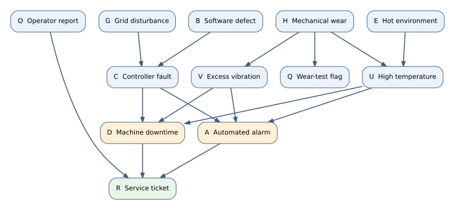

# Assignment 3 — Models, Bayesian Updating, and Graphical Reasoning

This assignment covers Lectures 12–16 from Weeks 7–9. It contains **five questions worth 100 points total**.

## Purdue Honor Pledge

> “As a Boilermaker pursuing academic excellence, I pledge to be honest and true in all that I do. Accountable together—We are Purdue.”

**When submitting this assignment via Gradescope, we assume that you commit to this honor pledge and submit your own work considering the instructions below.**

## Instructions

- Show the main steps in your reasoning. A correct numerical answer without supporting work may receive only partial credit.
- Unless explicitly stated otherwise, **compute** means work through the steps by hand. Show the algebra, differentiation, and probability calculations. You may use an arithmetic calculator to evaluate expressions after setting them up, but do not use code or a symbolic calculator to do the derivations.
- There is **no coding question** in this assignment. Use natural logarithms throughout; information quantities are measured in nats.
- Treat observations as conditionally independent given the model parameter where the question states this assumption. State any additional assumption you use.
- Submit a legible PDF on Gradescope and link each answer to its question.
- Please do your best to solve the questions without relying on an LLM. The goal is to be able to explain and apply the same ideas independently in a short follow-up quiz.

## Questions

### Question 1: Time until a machine fault (20 points)

A maintenance team records the waiting time $X$, in hours, from a machine's return to service until its next fault. Under stable operating conditions, a simple model is the exponential density

$$
p(x\mid\lambda)=
\begin{cases}
\lambda e^{-\lambda x},&x\geq 0,\\
0,&x<0,
\end{cases}
\qquad \lambda>0,
$$

where $\lambda$ is the fault rate per hour. The model is useful for a first calculation, but it assumes the fault rate does not change as the machine ages.

1. **Exponential-family form (6 points).** Start with $\log p(x\mid\lambda)$ for $x\geq0$. Rewrite the density as $h(x)\exp\{\eta T(x)-A(\eta)\}$. Identify $h(x)$, the sufficient-statistic function $T(x)$, the natural parameter $\eta$, and the log normalizer $A(\eta)$.
2. **Moments from the log normalizer (8 points).** Differentiate $A(\eta)$ to find $\mathbb E_{\eta}[T(X)]$ and $\operatorname{Var}_{\eta}(T(X))$. Convert your answers to $\mathbb E[X]$ and $\operatorname{Var}(X)$ in terms of $\lambda$, and give their units.
3. **A maintenance calculation (6 points).** If $\lambda=0.5$ faults per hour, use the density to find $P(X>2)$. Also find $P(X>4\mid X>2)$ and explain what the comparison means for a machine that has already run for two fault-free hours.
<!-- 4. **Model choice (4 points).** Suppose older machines become progressively more likely to fail during the next hour. Explain why the exponential model could give misleading maintenance advice. State what feature of the data or operating conditions you would examine before trusting it. -->

### Question 2: Does a prototype classifier beat chance? (18 points)

A team is testing a prototype binary classifier on comparable, independently sampled cases from a balanced evaluation setting. Let $X_i=1$ if it classifies case $i$ correctly and $X_i=0$ otherwise. For this exercise, assume the outcomes are conditionally independent Bernoulli trials with one unknown accuracy $\theta$. The team wants to know whether $\theta$ exceeds the chance-level benchmark $0.5$; this is an early diagnostic, not a deployment standard.

Before testing, the team assigns $\theta\sim\operatorname{Beta}(2,2)$. Four new cases produce $\mathcal D=(1,1,1,0)$.

1. **Posterior update (4 points).** Find the posterior distribution of $\theta$ and write its density. You may use $B(5,3)=1/105$.
2. **What does an interval say? (4 points).** An equal-tailed 95% credible interval for this posterior is approximately $[0.290,0.901]$. Interpret it in this setting, then explain how its meaning differs from that of a frequentist 95% confidence interval.
3. **Probability of beating chance (5 points).** Define $H_0:\theta\leq0.5$ and $H_1:\theta>0.5$. Set up and evaluate $P(H_1\mid\mathcal D)$ by integrating the posterior density over the appropriate region. Also give $P(H_0\mid\mathcal D)$.
4. **How much did the data change the odds? (5 points).** Find the prior odds and posterior odds of $H_1$ relative to $H_0$, then calculate $\mathrm{BF}_{10}$. Explain in one sentence what this Bayes factor measures.

<!-- Previous Question 2, retained as a draft but not assigned.

### Question 2: Incident counts, empirical KL, and maximum likelihood (18 points)

A service desk records the number of urgent incidents per day over five comparable days:

$$
\mathcal D=(0,1,1,2,1).
$$

Model daily counts as IID Poisson with mean $\lambda>0$. The team is comparing $q_1=\operatorname{Poisson}(1)$ and $q_2=\operatorname{Poisson}(2)$ for planning tomorrow's staffing. Use $q_{\lambda}(x)=e^{-\lambda}\lambda^x/x!$ for $x=0,1,\ldots$.

1. **Observed distribution and MLE (4 points).** Write the empirical distribution $\widehat p$ of the five counts, including its support. Derive the Poisson MLE from the sample log-likelihood and evaluate it for these data.
2. **Negative log-likelihood (4 points).** Calculate the total negative log-likelihood of the five observed days under $q_1$ and $q_2$, giving exact expressions and approximate values in nats.
3. **KL comparison (6 points).** Calculate $D_{\mathrm{KL}}(\widehat p\Vert q_1)$ and $D_{\mathrm{KL}}(\widehat p\Vert q_2)$, using $0\log(0/q)=0$.
4. **Staffing interpretation (4 points).** Which candidate is better supported by these five days? Under each candidate, calculate $P(X\geq2)$ for a new day.

-->

### Question 3: Updating beliefs about a backup generator (18 points)

A facility needs a backup generator to start when requested. Let $\theta$ be its unknown probability of starting successfully under the specified test conditions. Before the current tests, engineers consider three candidate values with these prior probabilities:

| Candidate $\theta$ | $1/4$ | $1/2$ | $3/4$ |
|---|---:|---:|---:|
| Prior probability | $1/4$ | $1/2$ | $1/4$ |

Two independent start attempts under the same conditions both fail so the current observed sequence is $\mathcal D=(0,0)$. Assume the same $\theta$ applies to both attempts.

1. **Why update a distribution? (5 points).** In this setting, explain what the parameter, prior, likelihood, evidence, and posterior mean. Give one reason to keep a distribution over candidate values after only two tests instead of reporting only a single maximum-likelihood estimate.
2. **Likelihood and evidence (5 points).** What distribution do you use to model the starting of this backup generator? Compute $p(\mathcal D\mid\theta)$ for each candidate. Multiply by its prior probability and calculate the evidence $p(\mathcal D)$.
3. **Posterior (5 points).** Calculate the posterior probability of each candidate and check that the three probabilities sum to one. Identify which candidate is most plausible after the failures, and compare it with the most plausible candidate before testing.
4. **Prediction (3 points).** Find the posterior predictive probability that the next start attempt succeeds. Briefly explain why this prediction is not simply the most plausible candidate value.

### Question 4: Updating a sensor-reliability estimate over time (22 points)

A warehouse uses a sensor to detect packages passing a checkpoint. Record $X_i=1$ when a package is detected and $X_i=0$ when detection is missed. Let $\theta$ be the sensor's detection probability while its hardware, calibration, and operating conditions stay unchanged. Conditional on $\theta$, treat the outcomes as independent Bernoulli observations.

Before any of the observations below, the team's starting prior is $\theta\sim\operatorname{Beta}(1,1)$. Six **historical** checks produced

$$
\mathcal D_{\mathrm{old}}=(1,1,0,1,0,1).
$$

After those checks, five **new** packages produced

$$
\mathcal D_{\mathrm{new}}=(1,0,1,1,0).
$$

1. **A prior informed by history (6 points).** Use only the six historical checks to find the Beta distribution that should be used as the prior immediately before the five new packages arrive. Show the success and failure counts. Explain why this is ordinary Bayesian updating rather than estimating an empirical-Bayes prior from several related sensors.
2. **Batch update (5 points).** Use that history-informed prior and all five new outcomes in one batch to find the posterior for $\theta$. Show the likelihood's powers of $\theta$ and $1-\theta$.
3. **Sequential update (5 points).** Instead update first with $(1,0)$ and then with $(1,1,0)$. Show both intermediate and final Beta distributions, and explain why the final result agrees with part 2.
4. **Decision and assumption (6 points).** Find the posterior predictive probability that the next package is detected. Explain what it means operationally, why the six historical checks must not be counted again in the new-data likelihood, and what would concern you if the sensor had been recalibrated between the historical and new checks.

### Question 5: Diagnosing faults with a directed graph (22 points)

A factory monitoring team wants to interpret alarms without assuming that every alarm has the same cause. The proposed model includes a software defect $B$, a grid-power disturbance $G$, mechanical wear $H$, and a hot environment $E$. These can lead to a controller fault $C$, excess vibration $V$, or high temperature $U$. The system may raise an automated alarm $A$, experience downtime $D$, generate a service ticket $R$, or produce a wear-test flag $Q$. An operator report $O$ is another possible reason for opening a service ticket. All 12 variables are binary.

For a d-separation conclusion, checking one path is not enough unless you also explain why every other path is blocked.

1. **Factorization (6 points).** Write the joint distribution of all 12 variables as a product of local conditional distributions.
2. **Two possible fault origins (6 points).** Are the roots $B$ and $H$ d-separated (i) with nothing observed, (ii) given only the service ticket $R$, and (iii) given both $R$ and the controller fault $C$?
3. **A root and a non-descendant leaf (5 points).** The wear-test flag $Q$ is a leaf and is not a descendant of $B$. Are $B$ and $Q$ d-separated (i) with nothing observed, (ii) given only $R$, and (iii) given both $R$ and $H$? Explain.
4. **Markov blanket (5 points).** Find the Markov blanket of the alarm $A$: list its parents, children, and co-parents. State which variables outside the blanket are screened off from $A$ once the blanket is observed. Explain why a ticket's other causes must be included even though they do not directly point to $A$.
