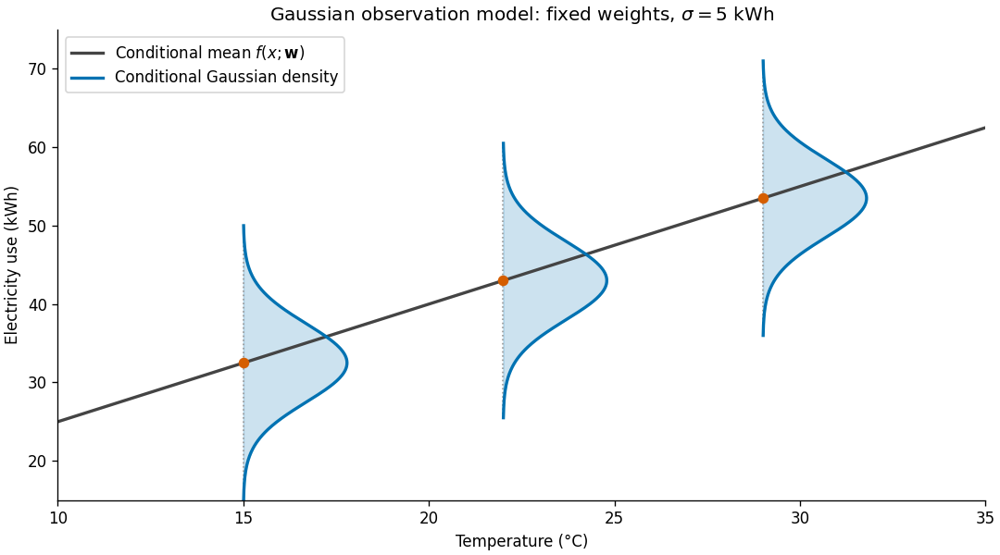
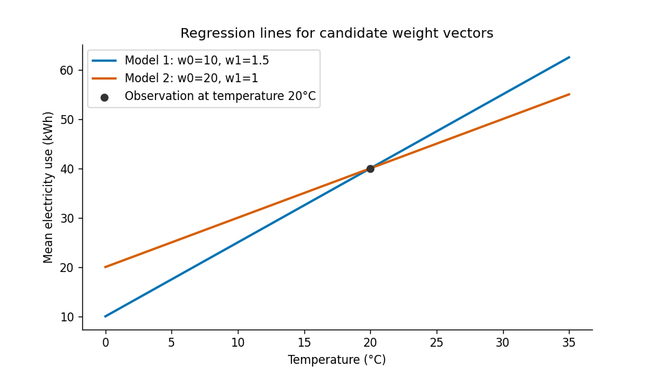
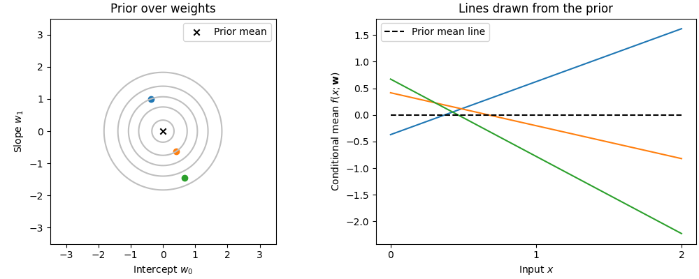
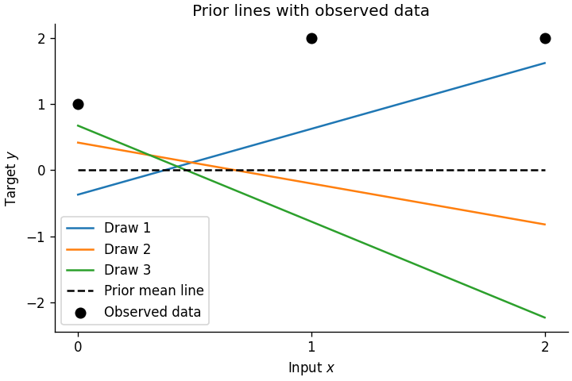
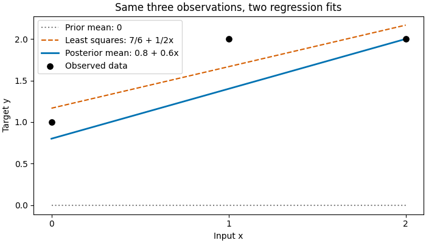

# Lecture 19 - Bayesian Linear Regression

In this lecture we return to our scenario from Lecture 17: predicting electricity use for a building.


:::{admonition} Scenario recap linear regression for temperature prediction: 

Temperature prediction: On a mild day, when little heating or cooling is needed, the building might use around 25 kWh. On a hot day, air conditioning might raise that to around 60 kWh. These are illustrative averages and actual use will vary from day to day even at the same temperature.

In the last lecture we used least squares and the MLE estimator to solve the problem. In this lecture, we adopt a Bayesian perspective and incorporate prior knowledge about the weights in the linear model to estimate the posterior after seeing the evidence.
:::

The guiding question for this lecture is: 

:::{admonition} 
:class: tip 
How can we incorporate prior knowledge in a linear regression model when we estimate the regression weights? 
:::

## Learning outcomes

After completing this lecture, you should be able to:

1. Specify a Bayesian linear regression model using a Gaussian likelihood and Gaussian prior.
2. Explain why this prior is conjugate.
3. Calculate and interpret the posterior mean and covariance. 
4. Explain the connection between a broad prior and the least-squares estimate.
5. Distinguish uncertainty about the fitted mean from uncertainty about a new observation.

## Notation

As in Lectures 17 and 18, we use $Y$ for the random target and $y$ for an observed value. In statistics, the random target variable $Y$ is also sometimes called the dependent variable. An input is $\mathbf x\in\mathbb R^D$ (also called an independent variable), and the training data are $\mathcal D=\{(\mathbf x_n,y_n)\}_{n=1}^N$. The inputs and observed targets are given, and the weights $\mathbf w$ and noise precision $\beta$ are unknown parameters, not random variables in the frequentist fit below.

## 1. Recap: Regression model from Lecture 17

To build intuition about the Bayesian regression model, let us return to the regression model we had built.

### 1.1 Formulating the regression model


As in the previous model, we specify temperature as the input $X$, and electricity use is our target $Y$.
We write $x_n$ for the observed temperature on day $n$ and $y_n$ for the electricity use measured that day.

We begin with a straight-line first-order regression model because we assume a linear relationship between input and target:

$$
f(x;\mathbf w)=w_0+w_1x,
$$

where $w_0$ is the intercept and $w_1$ is the slope. Under our zero-mean noise model, this function describes the expected electricity use at temperature $x$, given the weights $\mathbf w$.

Just like in Lecture 17, we can also formulate this using **general basis function notation**:

A basis function is a fixed function that transforms an input into a feature used by the regression model. The model multiplies each feature by a weight and adds the results.

For our straight line, choose

$$
\phi_0(x)=1,
\qquad
\phi_1(x)=x.
$$

We can write the same straight-line model in vector notation:

$$
\boldsymbol\phi(x)=
\begin{pmatrix}1\\x\end{pmatrix}.
$$

Then

$$
f(x;\mathbf w)
=
\mathbf w^{\mathsf T}\boldsymbol\phi(x)
=
w_0+w_1x.
$$

We could also assume an additional polynomial term and choose:
$\boldsymbol\phi(x)=(1,x,x^2)^{\mathsf T}$

This would give us the following regression model. 

$$
f(x;\mathbf w)=w_0+w_1x+w_2x^2.
$$

When would we do this? For example, if we assume a curved relationship between the electricity and the temperature (but the model remains linear in its unknown weights). 

For this lecture, however, we assume only a first-order linear regression model. When we learn the weights, we hold the basis functions fixed. 

## 1.2 The Gaussian likelihood

The observed electricity $y_n$ can differ from the regression
function's predicted mean $\mathbb E[Y\mid x,\mathbf w]=f(x;\mathbf w)$. We represent this variation using an additive Gaussian error:

$$
y_n
=
\mathbf w^{\mathsf T}\boldsymbol\phi(x_n)+\epsilon_n,
\qquad
\epsilon_n\sim\mathcal N(0,\beta^{-1}).
$$

Just like before, we assume that the errors are independent and have the same variance.
The parameter $\beta$ is the **noise precision**, or inverse variance:

$$
\beta=\frac{1}{\sigma^2}.
$$

A larger $\beta$ means less variation around the regression mean.
Throughout this lecture, we treat $\beta>0$ as known and fixed,
and focus on learning the weights $\mathbf w$.

#### The conditional distribution of one observation

Given the input, weights, and noise precision, the target follows

$$
p(y_n\mid x_n,\mathbf w,\beta)
=
\mathcal N\!\left(
y_n\mid
\mathbf w^{\mathsf T}\boldsymbol\phi(x_n),
\beta^{-1}
\right).
$$

Thus, $\mathbf w^{\mathsf T}\boldsymbol\phi(x_n)$ is the conditional
mean, while $\beta^{-1}$ describes the variation around that mean.

For example, if the conditional mean at a particular temperature
is 60 kWh and the noise standard deviation is 5 kWh, then

$$
Y_n\mid x_n,\mathbf w,\beta
\sim\mathcal N(60,25),
\qquad
\beta=\frac1{25}.
$$

The mean need not equal the electricity use actually measured
on a particular day.

#### The likelihood of all observations

Collect the observed targets into the vector

$$
\mathbf y=
\begin{pmatrix}
y_1\\
\vdots\\
y_N
\end{pmatrix}.
$$

As in Lecture 17, the design matrix contains one row of
basis-function values for each observed input:

$$
\boldsymbol\Phi=
\begin{pmatrix}
\boldsymbol\phi(x_1)^{\mathsf T}\\
\vdots\\
\boldsymbol\phi(x_N)^{\mathsf T}
\end{pmatrix}.
$$

With $N$ observations and $M$ basis functions,
$\boldsymbol\Phi$ is an $N\times M$ matrix. The vector
$\boldsymbol\Phi\mathbf w$ contains the conditional means
for all observations.

Conditional independence lets us multiply the Gaussian densities:

$$
\begin{aligned}
p(\mathbf y\mid\boldsymbol\Phi,\mathbf w,\beta)
&=
\prod_{n=1}^{N}
\mathcal N\!\left(
y_n\mid
\mathbf w^{\mathsf T}\boldsymbol\phi(x_n),
\beta^{-1}
\right)\\
&=
\left(\frac{\beta}{2\pi}\right)^{N/2}
\exp\left[
-\frac{\beta}{2}
\|\mathbf y-\boldsymbol\Phi\mathbf w\|_2^2
\right].
\end{aligned}
$$

Equivalently, this is a multivariate Gaussian density:

$$
p(\mathbf y\mid\boldsymbol\Phi,\mathbf w,\beta)
=
\mathcal N\!\left(
\mathbf y\mid\boldsymbol\Phi\mathbf w,
\beta^{-1}\mathbf I_N
\right).
$$

Here, $\mathbf I_N$ is the $N\times N$ identity matrix. The covariance
$\beta^{-1}\mathbf I_N$ expresses independent errors with equal variance.

With the observed data and $\beta$ fixed, this expression is a
function of the candidate weights. Viewed in this way, it is
the **likelihood**:

$$
\mathcal L(\mathbf w;\mathcal D,\beta)
=
p(\mathbf y\mid\boldsymbol\Phi,\mathbf w,\beta).
$$

At fixed $\beta$, weights producing smaller squared residuals
have a larger likelihood. This is the connection between Gaussian maximum likelihood and least squares established in Lecture 17.

It measures how well each candidate weight vector accounts for
the observed targets under our Gaussian sampling model. It is
not a probability density over the weights.

The figure below illustrates the Gaussian observation model for electricity use and the conditional mean for a fixed weight vector $\mathbf w$.



**Figure:** Gaussian observation model for electricity use.
The line shows the conditional mean for one fixed weight vector
$\mathbf w$. At three selected temperatures, the Gaussian
density curves show how electricity use varies around that mean.
Their common vertical spread illustrates the constant noise
variance $\beta^{-1}$. The horizontal width of each small density
curve represents density, not a change in temperature.

### 1.3 What changes in the Bayesian approach?

In Lecture 17, maximum likelihood selected the weight vector
that made the observed data most likely:

$$
\widehat{\mathbf w}_{\mathrm{ML}}
=
\arg\max_{\mathbf w}
p(\mathbf y\mid\boldsymbol\Phi,\mathbf w,\beta).
$$

Under our Gaussian noise model, this is also the least-squares
estimate. It gives us one fitted regression line:

$$
f(x;\widehat{\mathbf w}_{\mathrm{ML}})
=
\widehat w_0+\widehat w_1x.
$$

However, a fitted weight vector alone does not describe how uncertain
we are about the intercept and slope. With limited observations,
several different lines may remain plausible.

In Bayesian regression, we retain the same Gaussian likelihood
but introduce a **prior distribution** over the weights:

$$
p(\mathbf w).
$$

This distribution represents our assumptions about plausible
intercepts and slopes before observing the data used in this update.

We combine the prior with the likelihood using Bayes' rule:

$$
\boxed{
p(\mathbf w\mid\mathbf y,\boldsymbol\Phi,\beta)
=
\frac{
p(\mathbf y\mid\boldsymbol\Phi,\mathbf w,\beta)\,p(\mathbf w)
}{
p(\mathbf y\mid\boldsymbol\Phi,\beta)
}.
}
$$

The terms have the same roles as in our earlier Bayesian examples:

| Term | Meaning in regression |
|---|---|
| Prior $p(\mathbf w)$ | Initial uncertainty about the intercept and slope |
| Likelihood $p(\mathbf y\mid\boldsymbol\Phi,\mathbf w,\beta)$ | How well candidate weights account for the observed electricity use |
| Posterior $p(\mathbf w\mid\mathbf y,\boldsymbol\Phi,\beta)$ | Updated uncertainty about the weights after observing the data |
| Evidence $p(\mathbf y\mid\boldsymbol\Phi,\beta)$ | Normalizing factor that makes the posterior density integrate to one |

The evidence is obtained by integrating over the possible weight
vectors:

$$
p(\mathbf y\mid\boldsymbol\Phi,\beta)
=
\int
p(\mathbf y\mid\boldsymbol\Phi,\mathbf w,\beta)
p(\mathbf w)\,d\mathbf w.
$$

For our straight-line model, this integration is over both
$w_0$ and $w_1$.

The result of Bayesian inference is therefore a posterior
distribution over possible intercepts and slopes. Each weight
vector defines a regression line, so uncertainty about the
weights also represents uncertainty about the regression line.


Please note that our model assumes that the same unknown weights describe every observation:

$$
y_n=w_0+w_1x_n+\epsilon_n,
\qquad n=1,\ldots,N.
$$

We do not draw a new intercept and slope for each day. Instead, the temperatures and errors vary across days, while the same underlying regression relationship applies throughout the dataset.

There are two distinct sources of uncertainty:

- **Observation noise:** electricity use can vary even when the
  temperature and regression weights are specified. This is
  represented by $\epsilon_n$ and its variance $\beta^{-1}$.
- **Uncertainty about the weights:** we do not know the intercept
  and slope exactly. This is represented by the prior and posterior
  distributions over $\mathbf w$.

### 1.4 The simple three-point regression line

Recap: In this lecture, we will use the illustrative observations $(0,1)$, $(1,2)$, and $(2,2)$ from Lecture 17. Thus, we want to refresh our memory on it. These are numerical input–target pairs, not temperatures and electricity bills. Set the observation-noise precision to $\beta=1$ for this example.

With the straight-line model above, the maximum-likelihood weights are the least-squares weights:

$$
\widehat{\mathbf w}_{\mathrm{ML}}=(7/6,\,1/2)^{\mathsf T},
\qquad \widehat f_{\mathrm{ML}}(x)=7/6+0.5x.
$$


**Figure 2.** The line maximizes the Gaussian likelihood for the three observed points. The fitted weights alone do not tell us how uncertain we are about the intercept and slope.

### 1.5 A prior for the same intercept and slope

A prior distribution over $\mathbf w=(w_0,w_1)^{\mathsf T}$ expresses which lines we consider plausible before incorporating these observations. We choose a Gaussian prior:

$$
p(\mathbf w)=\mathcal N(\mathbf w\mid\mathbf m_0,\mathbf S_0).
$$

The two entries of $\mathbf m_0$ give the prior mean intercept and slope. The diagonal of $\mathbf S_0$ gives their variances; its off-diagonal entries describe how the two weights vary together.

For the three-point example we use a **zero-mean isotropic Gaussian**:

$$
\mathbf m_0=\mathbf 0,\qquad
\mathbf S_0=\alpha^{-1}\mathbf I_2,\qquad \alpha=1.
$$

Thus the intercept and slope are independent under the prior, each with mean zero and variance one in these numerical coordinates. The prior mean line is horizontal at zero. Other slopes and intercepts are plausible: zero is the center of the distribution, not a requirement on either weight.

| Precision | What does it control? |
|---|---|
| $\alpha$ — prior precision | How closely the plausible **weights** cluster around zero. |
| $\beta$ — noise precision | How closely the **observations** cluster around a given line. |

We chose both precisions to equal one for this example. They describe different sources of uncertainty.

## 2. Place a prior on the regression weights

Our next step is to choose a prior over the weights and calculate
how the observations update it.

### 2.1 From plausible weights to plausible curves

The intercept $w_0$ and slope $w_1$ control the shape of the regression model. If $w_0$ increases, the whole line shifts upward. If $w_1$ increases, the line becomes steeper.
You can think of a prior over the weights as uncertainty about the shape of the curve.

For our straight-line model,

$$
f(x;\mathbf w)=w_0+w_1x,
$$

the intercept $w_0$ determines the conditional mean at $x=0$,
while the slope $w_1$ determines how that mean changes when
temperature increases by one unit.

Different weight vectors therefore describe different relationships.
For example,

$$
\mathbf w^{(1)}
=
\begin{pmatrix}10\\1.5\end{pmatrix},
\qquad
\mathbf w^{(2)}
=
\begin{pmatrix}20\\1.0\end{pmatrix}
$$

give the lines

$$
f(x;\mathbf w^{(1)})=10+1.5x,
\qquad
f(x;\mathbf w^{(2)})=20+x.
$$

Both predict a mean electricity use of 40 kWh at $20^\circ$C,
but they predict different changes as temperature increases.

The figure below shows this: 



Before observing the data, we may consider several such lines
plausible. A **prior distribution over the weights** represents
these assumptions. Each draw of a weight vector from the prior gives one complete
regression line. Drawing several weight vectors therefore produces
several possible lines.

This represents uncertainty about the underlying relationship.
It is separate from the observation noise that causes electricity
use to vary around any one of these lines.


### 2.2 Choosing a Gaussian prior

In this lecture, we choose a multivariate Gaussian prior:

$$
p(\mathbf w)
=
\mathcal N(\mathbf w\mid\mathbf m_0,\mathbf S_0).
$$

Here, $\mathbf m_0$ is the prior mean vector and $\mathbf S_0$
is the prior covariance matrix. The subscript $0$ indicates
that these describe our assumptions before incorporating the
observations in this update.

For the two weights in our straight-line model,

$$
\mathbf m_0
=
\begin{pmatrix}
m_{0,0}\\
m_{0,1}
\end{pmatrix},
\qquad
\mathbf S_0
=
\begin{pmatrix}
s_{00} & s_{01}\\
s_{01} & s_{11}
\end{pmatrix}.
$$

The mean vector specifies the prior expected intercept and slope:

$$
\mathbb E[w_0]=m_{0,0},
\qquad
\mathbb E[w_1]=m_{0,1}.
$$

The diagonal entries of the covariance matrix describe uncertainty
about each weight:

$$
\operatorname{Var}(w_0)=s_{00},
\qquad
\operatorname{Var}(w_1)=s_{11}.
$$

Larger variances allow a wider range of plausible intercepts or
slopes. The off-diagonal entry describes how they vary together:

$$
\operatorname{Cov}(w_0,w_1)=s_{01}.
$$

A positive covariance associates larger intercepts with larger
slopes. A negative covariance associates larger intercepts with
smaller slopes. For a joint Gaussian prior, zero covariance means
the two weights are independent.

For example, an illustrative prior could be

$$
\mathbf m_0
=
\begin{pmatrix}10\\1.5\end{pmatrix},
\qquad
\mathbf S_0
=
\begin{pmatrix}
25 & 0\\
0 & 0.25
\end{pmatrix}.
$$

This gives a prior mean intercept of 10 kWh with standard deviation
5 kWh, and a prior mean slope of 1.5 kWh per degree Celsius with
standard deviation 0.5 kWh per degree Celsius.

The mean of the regression function under this prior is

$$
\mathbb E_{\mathbf w}[f(x;\mathbf w)]
=
\mathbf m_0^{\mathsf T}\boldsymbol\phi(x)
=
10+1.5x.
$$

Individual weight vectors drawn from the prior produce lines
around this prior mean function.

A prior may reflect information from previous studies, engineering
knowledge, or deliberately broad assumptions. Its parameters
should describe plausible weights in the chosen units.

We use a Gaussian prior because it is mathematically convenient:
combined with our Gaussian likelihood, it gives a Gaussian
posterior. We will derive this conjugate update in Section 3.

### 2.3 A simple prior for the worked example

In Section 2.2, we chose a prior for predicting the temperature of a building. The intercept was measured in kWh and the slope in kWh per degree Celsius. We chose
a different prior variance for each weight because the two weights
have different meanings and units.

To better understand the effect of the prior, and perform hand computation, let's return to the small numerical example from Lecture 17:

$$
(x_1,y_1)=(0,1),\qquad
(x_2,y_2)=(1,2),\qquad
(x_3,y_3)=(2,2).
$$

We treat these as illustrative numerical values rather than temperatures
and electricity bills. We use the same straight-line model,
$f(x;\mathbf w)=w_0+w_1x$, and choose a simple Gaussian prior:

$$
\mathbf w\mid\alpha
\sim \mathcal N(\mathbf 0,\alpha^{-1}\mathbf I_2).
$$

What does this choice say about the two weights? Before seeing the
three observations, both the intercept and the slope have prior mean
zero and variance $1/\alpha$. They are independent under this prior.
A larger $\alpha$ concentrates the plausible weights closer to zero.

For this example, set $\alpha=1$. Our starting point is therefore

$$
\mathbf m_0=
\begin{pmatrix}0\\0\end{pmatrix},
\qquad
\mathbf S_0=
\begin{pmatrix}1&0\\0&1\end{pmatrix}.
$$

The prior mean line is $f(x;\mathbf m_0)=0$. This does not mean that
every plausible line is horizontal: a draw from the prior generally
has a nonzero intercept and slope.

We also set the observation-noise precision to $\beta=1$. Although
we chose the same numerical value for both precisions, they describe
different things:

For the hand calculation, we set $\alpha=1$ and $\beta=1$.
These are two separate modeling choices:

- **Prior precision $\alpha$** controls the spread of the weights
  before we observe the data. Setting $\alpha=1$ gives the intercept
  and slope a prior variance of $1/\alpha=1$ each.
- **Noise precision $\beta$**, introduced in Section 1.2, controls
  the spread of observations around a given line. Setting $\beta=1$
  gives the observation error a variance of $1/\beta=1$.

#### Relating different draws to different regression lines 

With $\alpha=1$, our prior is
$\mathbf w\sim\mathcal N(\mathbf 0,\mathbf I_2)$.
Our first draw gives an intercept of approximately $-0.370$
and a slope of $0.994$. Together, they define the line

$$
f(x;\mathbf w^{(1)})\approx -0.370+0.994x.
$$

We can now evaluate this line at the three inputs from our worked example:

$$
\begin{aligned}
f(0;\mathbf w^{(1)}) &\approx -0.370,\\
f(1;\mathbf w^{(1)}) &\approx -0.370+0.994=0.624,\\
f(2;\mathbf w^{(1)}) &\approx -0.370+2(0.994)=1.618.
\end{aligned}
$$

A second draw gives a different intercept and slope, and hence a
different line. Here are three draws from the same prior:

| Draw | Intercept $w_0$ | Slope $w_1$ | $f(0)$ | $f(1)$ | $f(2)$ |
|---|---:|---:|---:|---:|---:|
| 1 | −0.370 | 0.994 | −0.370 | 0.624 | 1.618 |
| 2 | 0.416 | −0.618 | 0.416 | −0.202 | −0.820 |
| 3 | 0.672 | −1.450 | 0.672 | −0.778 | −2.228 |

These are conditional means calculated from the sampled weights.
We have used the input values $0,1,2$, but we have not yet used the
observed targets $1,2,2$. Those enter in Section 3, when we update
the weights.

The following figure illustrates how your draw from the prior impacts the slope of the line for the example above. 




**Figure:** The left panel shows the joint Gaussian prior over the
intercept and slope for the worked example. Each colored point is
one draw $(w_0,w_1)$; the matching line on the right is
$f(x;\mathbf w)=w_0+w_1x$. The black cross at $(0,0)$ corresponds
to the dashed prior mean line. The three observed target values
have not yet been used to update the weights.


## 3. Update on our belief in the weights using the observed data

In Section 2.3, we drew three lines from the prior. We used the inputs
$x=0,1,2$ to draw them, but we did not use the observed targets. Now bring those targets into the picture. The Bayesian update mechanism starts to work.

| Input $x_n$ | Observed target $y_n$ |
|---:|---:|
| 0 | 1 |
| 1 | 2 |
| 2 | 2 |

How do these observations change our beliefs about the intercept and the slope? 

Consider the observation at $x=2$, where we measured $y=2$.
The first line in our figure gives a mean of approximately $1.618$
at this input. The third gives a mean of approximately $-2.228$.

Under our Gaussian observation model, the value $y=2$ has a higher
density under the first line: it lies closer to that line's mean.
This one observation therefore favors the first line over the third.
The full likelihood makes this comparison using **all three observations**.

Bayes' rule combines that likelihood with the prior:

$$
p(\mathbf w\mid\mathbf y,\boldsymbol\Phi,\beta)
\propto
\underbrace{p(\mathbf y\mid\boldsymbol\Phi,\mathbf w,\beta)}
_{\text{how well the line fits the observations}}
\underbrace{p(\mathbf w)}
_{\text{prior density at those weights}}.
$$

> Note: The three lines in the figure are illustrations. We do not have to
choose one of them. The update applies to **every possible intercept
and slope**, giving us a posterior distribution over regression lines.

### 3.1 Conjugacy and posterior calculation

Recall conjugacy from Lecture 14: a conjugate update keeps the
distribution in the same family while changing its parameters.
Here, the prior over the weights is Gaussian. The Gaussian
log-likelihood is quadratic in the weights because the regression
mean is linear in them. Adding the Gaussian log-prior gives another
quadratic, so the posterior over the weights is also Gaussian:

$$
p(\mathbf w\mid\mathbf y,\boldsymbol\Phi,\beta)
=
\mathcal N(\mathbf w\mid\mathbf m_N,\mathbf S_N).
$$

We therefore need to calculate just two quantities: the updated
mean vector $\mathbf m_N$ and covariance matrix $\mathbf S_N$.
The subscript $N$ means that we have incorporated $N$ observations.

**First, calculate the posterior precision.** Precision is the
inverse of covariance:

$$
\boxed{
\mathbf S_N^{-1}
=
\underbrace{\mathbf S_0^{-1}}_{\text{prior precision}}
+
\underbrace{\beta\boldsymbol\Phi^{\mathsf T}\boldsymbol\Phi}
_{\text{precision contributed by the observations}}.
}
$$

This equation tells us how the locations of the inputs and the
observation noise affect what we can learn about the weights.
For example, if every observation were taken at $x=0$, each model
mean would equal $w_0$. Those measurements would tell us about
the intercept, but they would not directly measure the slope.

**Next, calculate the posterior mean:**

$$
\boxed{
\mathbf m_N
=
\mathbf S_N
\left(
\mathbf S_0^{-1}\mathbf m_0
+
\beta\boldsymbol\Phi^{\mathsf T}\mathbf y
\right).
}
$$

Notice where the measured targets $\mathbf y$ appear: they help
determine **where the posterior is centered**. With known noise
precision $\beta$, the posterior covariance depends on where we
measured and how noisy the measurements are; it does not depend
on the particular target values we obtained.

For our worked example, $\mathbf m_0=\mathbf 0$, $\mathbf S_0=\mathbf I_2$,
and $\beta=1$. The two calculations simplify to

$$
\mathbf S_N^{-1}=\mathbf I_2+\boldsymbol\Phi^{\mathsf T}\boldsymbol\Phi,
\qquad
\mathbf m_N=\mathbf S_N\boldsymbol\Phi^{\mathsf T}\mathbf y.
$$

Next, we will evaluate these expressions for our three observations and compare the resulting line with the least-squares fit. We will use the simple example from above to do so. The following figure illustrates this:

 

**Figure:** Candidate lines, versus observations. 

### 3.2 Fit the data using Bayesian update

To illustrate the Bayesian fitting, let us return to the three observations $(0,1)$, $(1,2)$, and $(2,2)$.
We use the same straight-line model as before:

$$
f(x;\mathbf w)=w_0+w_1x.
$$

Each row of the design matrix is $(1,x_n)$, and the corresponding
entry of $\mathbf y$ is the observed target $y_n$. Thus,

$$
\boldsymbol\Phi=
\begin{pmatrix}
1&0\\
1&1\\
1&2
\end{pmatrix},
\qquad
\mathbf y=
\begin{pmatrix}1\\2\\2\end{pmatrix}.
$$

In Lecture 17, least squares gave an intercept of $7/6$ and a
slope of $1/2$. Under our Gaussian observation model, these are
also the maximum-likelihood estimates:

$$
\widehat{\mathbf w}_{\mathrm{ML}}
=
\begin{pmatrix}7/6\\1/2\end{pmatrix}.
$$

For the Bayesian fit, we keep the same observations and likelihood.
From Section 2.3, our prior is Gaussian with mean
$\mathbf m_0=\mathbf 0$ and covariance $\mathbf S_0=\mathbf I_2$
(prior precision $\alpha=1$). We also fix the observation-noise
precision at $\beta=1$.

The posterior can be calculated exactly as we will explain later. However, to make it easier for you, please run the following code to get the posterior. Each row of the design matrix is $[1,x_n]$. The first call to `solve` finds the posterior mean; the second obtains the covariance from the precision.

```python
import numpy as np

x = np.array([0., 1., 2.])
y = np.array([1., 2., 2.])
Phi = np.column_stack((np.ones_like(x), x))

alpha = 1.0
beta = 1.0
I = np.eye(2)

precision = alpha * I + beta * (Phi.T @ Phi)
m_N = np.linalg.solve(precision, beta * (Phi.T @ y))
S_N = np.linalg.solve(precision, I)

print("Posterior mean:", m_N)
print("Posterior covariance:")
print(S_N.round(3))
```

The results are as follows:

| Quantity | Prior | Posterior |
|---|---:|---:|
| Mean intercept | 0 | 0.8 |
| Mean slope | 0 | 0.6 |
| Intercept variance | 1 | 0.400 |
| Slope variance | 1 | 0.267 |
| Covariance between intercept and slope | 0 | −0.200 |


:::{admonition} Calculation by hand
:class: dropdown

**Step 1. Calculate the posterior precision.**

The update from Section 3 adds the prior precision to the precision
contributed by the observations:

$$
\mathbf S_N^{-1}
=
\mathbf S_0^{-1}
+
\beta\boldsymbol\Phi^{\mathsf T}\boldsymbol\Phi.
$$

First calculate the matrix product that also appeared in the
least-squares normal equations:

$$
\boldsymbol\Phi^{\mathsf T}\boldsymbol\Phi
=
\begin{pmatrix}1&1&1\\0&1&2\end{pmatrix}
\begin{pmatrix}1&0\\1&1\\1&2\end{pmatrix}
=
\begin{pmatrix}3&3\\3&5\end{pmatrix}.
$$

Since $\mathbf S_0^{-1}=\mathbf I_2$ and $\beta=1$, the update is

$$
\mathbf S_N^{-1}
=
\begin{pmatrix}1&0\\0&1\end{pmatrix}
+
\begin{pmatrix}3&3\\3&5\end{pmatrix}
=
\begin{pmatrix}4&3\\3&6\end{pmatrix}.
$$

**Step 2. Invert the precision to obtain the posterior covariance.**

The determinant is $4(6)-3(3)=15$. Using the inverse formula
for a $2\times2$ matrix gives

$$
\mathbf S_N
=
\begin{pmatrix}4&3\\3&6\end{pmatrix}^{-1}
=
\frac1{15}
\begin{pmatrix}6&-3\\-3&4\end{pmatrix}.
$$

The diagonal entries are the posterior variances: $6/15$ for the
intercept and $4/15$ for the slope. Both are smaller than their
prior variance of 1. The negative covariance, $-3/15$, means that
under the posterior, a higher intercept tends to go with a lower slope.

**Step 3. Calculate the posterior mean.**

The general update is

$$
\mathbf m_N
=
\mathbf S_N
\left(\mathbf S_0^{-1}\mathbf m_0
+\beta\boldsymbol\Phi^{\mathsf T}\mathbf y\right).
$$

Because $\mathbf m_0=\mathbf 0$ and $\beta=1$, this simplifies to
$\mathbf m_N=\mathbf S_N\boldsymbol\Phi^{\mathsf T}\mathbf y$.
This is where the measured target values enter:

$$
\boldsymbol\Phi^{\mathsf T}\mathbf y
=
\begin{pmatrix}1&1&1\\0&1&2\end{pmatrix}
\begin{pmatrix}1\\2\\2\end{pmatrix}
=
\begin{pmatrix}
1+2+2\\
0(1)+1(2)+2(2)
\end{pmatrix}
=
\begin{pmatrix}5\\6\end{pmatrix}.
$$

Multiplying by the posterior covariance gives

$$
\mathbf m_N
=
\frac1{15}
\begin{pmatrix}6&-3\\-3&4\end{pmatrix}
\begin{pmatrix}5\\6\end{pmatrix}
=
\frac1{15}
\begin{pmatrix}30-18\\-15+24\end{pmatrix}
=
\begin{pmatrix}0.8\\0.6\end{pmatrix}.
$$
:::

**What did the Bayesian fit give us?** The posterior mean line is
$f(x;\mathbf m_N)=0.8+0.6x$, compared with the least-squares line
$\widehat f_{\mathrm{LS}}(x)=7/6+0.5x$. The Bayesian result also
includes $\mathbf S_N$, which describes the uncertainty remaining
about the intercept and slope. Because this posterior is Gaussian,
its mean is also its mode: $\widehat{\mathbf w}_{\mathrm{MAP}}=\mathbf m_N$.



Figure: The points and dashed least-squares line are unchanged from above (dashed orange line). The blue line is the posterior mean from the Bayesian update. 

At $x=0$ we can read the intercepts directly: the least-squares estimate is $7/6$, whereas the posterior mean is $0.8$. The slope changes from $0.5$ to $0.6$. A zero-centered prior need not move each individual coefficient toward zero relative to least squares: the intercept and slope determine the fit together.

The **maximum a posteriori (MAP)** estimate is the weight vector at which the posterior density is largest. For this Gaussian posterior, the mode and mean coincide, so the solid line is also the MAP line. If we make the prior progressively broader ($\alpha\to 0$) while keeping $\beta$ fixed, the MAP weights approach the least-squares weights. This works here because the two columns of $\boldsymbol\Phi$ are linearly independent.

**Check your understanding:** If someone reported only the line $0.8+0.6x$, what would you still want to know? Use one entry of the posterior covariance matrix to explain what the line alone leaves out.


## Practice exercises

Use the same three observations throughout: $(0,1)$, $(1,2)$, and $(2,2)$. The model is $f(x;\mathbf w)=w_0+w_1x$, with independent Gaussian observation errors and fixed noise precision $\beta=1$.

### 1. Which line does the likelihood favor?

Consider two candidate lines: $f_A(x)=1+x$ and $f_B(x)=1$. Both give the same mean at $x=0$. Before calculating, which do you expect the observations to favor? For each line, calculate its three fitted means and its sum of squared residuals. Does the line with the higher likelihood need to pass through every point?

:::{admonition} Solution 1
:class: dropdown

Line A gives means $(1,2,3)$ and residuals $(0,0,-1)$, so its sum of squared residuals is 1. Line B gives means $(1,1,1)$ and residuals $(0,1,1)$, so its sum is 2. At the same noise precision, the smaller sum gives line A the higher Gaussian likelihood. It misses the last point, but fits the three observations better overall. This comparison uses only the likelihood.
:::

### 2. What does the posterior tell us beyond a fitted line?

With the prior $\mathbf w\sim\mathcal N(\mathbf 0,\mathbf I_2)$, the posterior mean is $(0.8,0.6)^{\mathsf T}$. Use it to find the posterior mean line's value at $x=1$. The observed target there is 2. Does the difference mean the update was calculated incorrectly? The posterior covariance between intercept and slope is $-0.2$: explain how an increase in the intercept could be offset by a change in slope at this input.

:::{admonition} Solution 2
:class: dropdown

At $x=1$, the posterior mean line gives $0.8+0.6=1.4$. The observed target is 0.6 above it. The line summarizes our estimate of the conditional mean; an individual observation can differ from it even if the weights were known. At this input the line height is $w_0+w_1$, so raising the intercept by 0.1 and lowering the slope by 0.1 leaves the height unchanged. The negative covariance tells us that higher intercepts tend to accompany lower slopes among plausible lines. It does not require an exact offset in every draw.
:::

### 3. What happens if we broaden the prior?

In the lecture's Python example, change only the prior precision from `alpha = 1.0` to `alpha = 0.01`. Before running the code, predict whether the posterior mean line will move closer to the prior mean line or to the least-squares line. Rerun the update and compare the new weights with the least-squares weights $(7/6,1/2)^{\mathsf T}$. Why is it important to leave `beta` unchanged for this comparison?

:::{admonition} Solution 3
:class: dropdown

The prior variance of each weight increases from 1 to 100. The prior now gives more similar density to candidate weights near the least-squares solution, so the likelihood has more influence on the fit. The posterior mean changes from $(0.800,0.600)^{\mathsf T}$ to approximately $(1.160,0.503)^{\mathsf T}$, close to the least-squares weights $(1.167,0.500)^{\mathsf T}$. Keeping $\beta$ fixed keeps the assumed observation noise and the likelihood unchanged, so we can attribute the difference to the prior.
:::


## References

Christopher M. Bishop, *Pattern Recognition and Machine Learning*, Chapter 3, pages 136–142 (especially Section 3.1 and Section 3.1.1).

