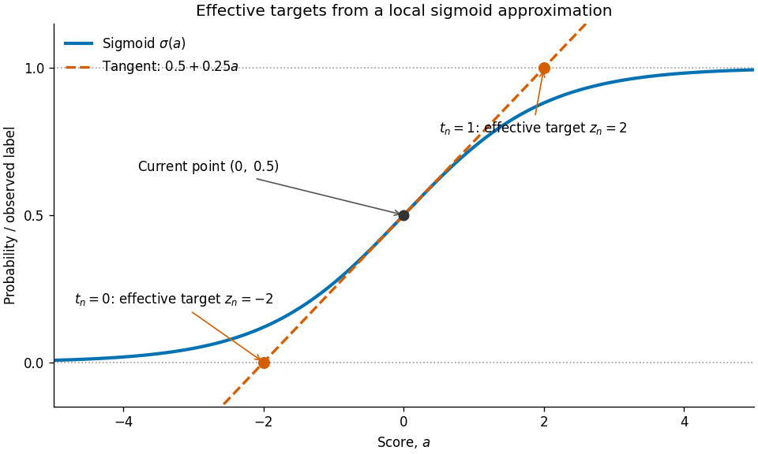
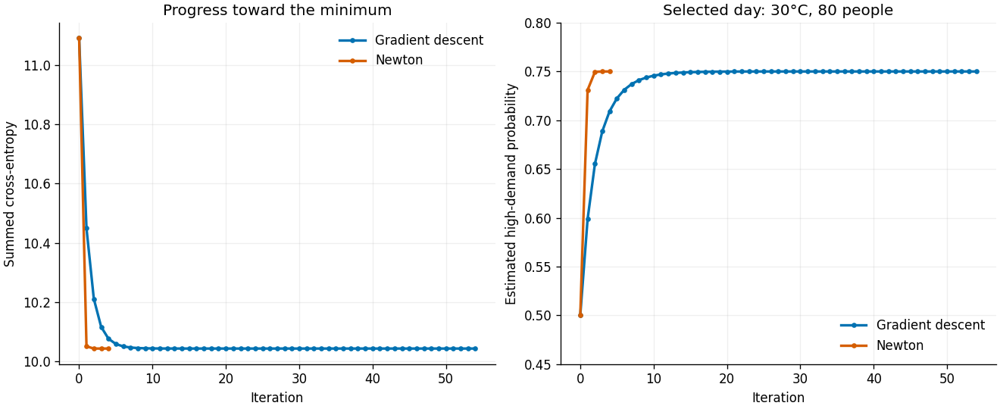

# Lecture 22 - Iterative reweighted least square (Newton's method and IRLS)

In Lecture 20 and 21 we discussed Discriminant functions and the Logistic Regression model, where the goal was to classify observed data. 

Specifically we asked how an operator of a building could answer the following question: *Will tomorrow be a high-demand day that requires extra capacity, or a normal day?* This question implies that an exact kWh prediction is no longer the immediate goal of pattern recognition. Instead we want to assign one of two **class labels**. In lecture 21, we adopted a probablistic perspective towards this **binary classification** problem, and introduced the logistic regression. This lecture directly connects to the logistic regression, and introduces a method to solve the logistic regression problem called "Newton's method". 

:::{admonition} Guiding question
:class: tip

How can we solve a logistic regression - despite the absence of a closed form solution - iteratively using Newton's method, a second order optimization method and why can each update be computed using weighted least squares?
:::

## Learning objectives

After completing this lecture, you should be able to:
1. Explain why logistic maximum-likelihood estimation generally requires iteration.
2. Distinguish gradient descent from Newton’s method. 
3. Compute one Newton update for a simple logistic regression model by hand, and interpret the change in predicted probability.
4. Explain and implement an iteratively reweighted least squares (IRLS) iteration, distinguishing the observed labels from the effective target, and experimentally compare its performance with the Gradient descent algorithm. 

## 1. Recap from lecture 20/21: 

### 1.1. From scores to probabilities 

In lecture 21, we had started with the score $a$ and defined it as function of weighted basis functions (also referred to as features): 

$$
a(\mathbf x)=\mathbf w^{\mathsf T}\boldsymbol\phi(\mathbf x).
$$

The first basis function is usually $\phi_0(\mathbf x)=1$, and $w_0$ acts as a form of a bias (please note that this term bias should not be confused with statistical bias, in statistics this bias term is sometimes also referred as intercept or constant of the regression model). If we use the original inputs plus the $\phi_0(\mathbf x)=1$, our feature vector is $\boldsymbol\phi(\mathbf x)=(1,x_1,\ldots,x_D)^{\mathsf T}$. 
We then converted $a$ to real values that lie between zero and one using the **logistic sigmoid**: 

$$
\boxed{\sigma(a)=\frac{1}{1+e^{-a}},\qquad
y(\mathbf x)=\sigma\!\left(\mathbf w^{\mathsf T}\boldsymbol\phi(\mathbf x)\right).}
$$

Here $\sigma$ is also called a nonlinear mapping from scores to probabilities.

When $a=0$, $y=1/2$. Positive scores give $y>1/2$, while negative scores give $y<1/2$. For example, scores $-1$, $0$, and $1$ give probabilities of approximately $0.269$, $0.500$, and $0.731$. As $a$ increases without bound, $y$ approaches $1$; as it decreases without bound, $y$ approaches $0$. For finite weights and features it never equals either endpoint exactly.

### 1.2. The Bernoulli model and cross-entropy minimization

We defined the probability model for probalistic classification model as following: 

Let $\mathcal D=\{(\mathbf x_n,t_n)\}_{n=1}^{N}$ be the labeled training set, and abbreviate

$$
\boldsymbol\phi_n=\boldsymbol\phi(\mathbf x_n),
\qquad a_n=\mathbf w^{\mathsf T}\boldsymbol\phi_n,
\qquad y_n=\sigma(a_n).
$$

Assuming the labels are conditionally independent given their inputs and the shared weights, their conditional likelihood is the product of their Bernoulli probabilities:

$$
\boxed{p(\mathbf t\mid\mathbf X,\mathbf w)
=\prod_{n=1}^{N}y_n^{t_n}(1-y_n)^{1-t_n}.}
$$

The inputs $\mathbf X=(\mathbf x_1,\ldots,\mathbf x_N)$ are treated as given. The model does **not** claim that all labels have the same success probability: $y_n$ can differ from day to day because the inputs differ. Their probabilities are tied together by the same $\mathbf w$.

Further, we learned that this **negative log-likelihood** for the logistic, also called **binary cross-entropy** for these observed labels, is 

$$
\boxed{E(\mathbf w)
=-\sum_{n=1}^{N}\left[t_n\log y_n+(1-t_n)\log(1-y_n)\right].}
$$

## 1.3. Minimizing binary cross-entropy.

To find a solution we have to minimize the binary cross-entropy. To do so, we take the derivative $\nabla{E(w)}_w$. 

In the prior lecture we had derived this, using the chain rule: 

$$
\boxed{\nabla_{\mathbf w}E(\mathbf w)
=\sum_{n=1}^{N}(y_n-t_n)\boldsymbol\phi_n.}
$$

There is generally no closed-form solution for this problem (with the exception discussed later in §3.3). Setting this gradient to zero does not produce a simple closed-form expression for $\mathbf w$, because each $y_n=\sigma(\mathbf w^{\mathsf T}\boldsymbol\phi_n)$ depends nonlinearly on the unknown weights. 

We learned in lecture 18, that we can use Gradient descent to approximate a solution iteratively. Instead of using gradient descent from lecture 18, we will now move to Newton's method, a second-order gradient-based method to solve this equation for $w$. 

## 2. Newton's method overview

Gradient descent, introduced in Lecture 18, uses first derivatives to determine an update. Newton's method adds the second derivatives, which describe the curvature of the objective. 

Newton's method can be used to find roots of a function $f(x)$ but it can also be applied to the derivate of a function $\nabla{f}$. We apply in the context of our binary classification task where we seek to minimize the minimizing the cross-entropy likelihood. 
Thus, in our case the objective function $E(w)$ with one unknown weight $w$ is where we apply Newtons' method to.  We seek a stationary point where $E'(w)=0$.

### 2.1. The quadratic approximation

Essentially, Newton's method performs a second-order Taylor expansion of the objective function, which gives: 

$$
E(w+\Delta w)
\approx
E(w)+E'(w)\Delta w
+\frac12 E''(w)(\Delta w)^2.
$$

Here:

- $E'(w)$ is the slope of the objective at the current weight.
- $E''(w)$ is its curvature.
- $\Delta w$ is the proposed change in the weight.

We choose $\Delta w$ by minimizing this quadratic approximation.
Differentiating the approximation with respect to $\Delta w$
and setting the result to zero gives

$$
E'(w)+E''(w)\Delta w=0.
$$

When $E''(w)>0$, the approximation has a minimum, located at

$$
\Delta w=-\frac{E'(w)}{E''(w)}.
$$

The Newton update is therefore

$$
\boxed{
w_{\mathrm{new}}
=
w-\frac{E'(w)}{E''(w)}.
}
$$

Unlike gradient descent, Newton's method uses curvature to scale the update by including the second-order derivative (Hint: For the same slope, greater positive curvature produces a smaller step). 

### 2.2. From one weight to several weights

With several weights, the gradient $\nabla E(\mathbf w)$ contains
the first derivatives. The Hessian $\mathbf H(\mathbf w)$ contains
the second derivatives:

$$
H_{ij}(\mathbf w)
=
\frac{\partial^2 E(\mathbf w)}
{\partial w_i\,\partial w_j}.
$$

The quadratic approximation becomes

$$
E(\mathbf w+\Delta\mathbf w)
\approx
E(\mathbf w)
+
\nabla E(\mathbf w)^{\mathsf T}\Delta\mathbf w
+
\frac12
\Delta\mathbf w^{\mathsf T}
\mathbf H(\mathbf w)
\Delta\mathbf w.
$$

When the Hessian is positive definite [[^positive-definite]], this approximation has
a unique minimum. Its location satisfies

$$
\boxed{
\mathbf H(\mathbf w)\Delta\mathbf w
=
-\nabla E(\mathbf w).
}
$$

We solve this linear system for $\Delta\mathbf w$ and then update:

$$
\mathbf w_{\mathrm{new}}
=
\mathbf w+\Delta\mathbf w.
$$

In prior lecture 18, we had learned about Gradient descent. If you compare the two methods, you can see that they use different updates:

$$
\begin{aligned}
\text{Gradient descent:}\qquad
\mathbf w_{\mathrm{new}}
&=
\mathbf w-\eta\nabla E(\mathbf w),
\\[2mm]
\text{Newton's method:}\qquad
\mathbf w_{\mathrm{new}}
&=
\mathbf w-\mathbf H(\mathbf w)^{-1}\nabla E(\mathbf w).
\end{aligned}
$$

The inverse makes the mathematical comparison clear. 

### 2.3. Damped Newton's update

The quadratic approximation describes the objective locally, meaning closely related to the weights found at a particular point in the iterative search for the best weight $w$. Its minimum need not be the global minimum of the actual objective, and a full Newton step can sometimes increase the loss.

When applying the so called damped Newton's method, we can therefore shorten the step:

$$
\mathbf w_{\mathrm{new}}
=
\mathbf w+\lambda\Delta\mathbf w,
\qquad 0<\lambda\leq1.
$$

Here $\lambda=1$ gives the full Newton step. If that step increases the objective, we can try a smaller value of $\lambda$. 

With this background on the Newton's method as second-order iterative gradient descent method, we can now apply it to the logistic regression. We start with a simple one classification model and perform a single update with an intercept-only model (the bias term $\phi_0(\mathbf{x})$). 

## 3. One Newton update for a simple classification model

### 3.1 Start with an constant-term model only 

We first simplify our building example from above, and we are leaving out the varying input features (e.g. temperature and occupancy) for illustrative purposes only. We only focus on the constant term, and the related weight $w_0$, that constitutes the probabilistic assignment to the binary classification. To make the first Newton update easy to calculate, we temporarily
leave out temperature and occupancy.

With both inputs included, our basis functions would be

$$
\phi_0(\mathbf x)=1,
\qquad
\phi_1(\mathbf x)=x_1,
\qquad
\phi_2(\mathbf x)=x_2,
$$

where $x_1$ represents temperature and $x_2$ represents occupancy.
The score would then be

$$
a(\mathbf x)
=
w_0+w_1x_1+w_2x_2.
$$

For this simplified example, we retain only the constant basis
function $\phi_0(\mathbf x)=1$. There is therefore just one
unknown weight, the intercept $w_0$:

$$
a_n=w_0\phi_0(\mathbf x_n)=w_0.
$$

Applying the sigmoid gives

$$
y_n=\sigma(w_0)=\frac{1}{1+e^{-w_0}}.
$$

Because the model no longer uses features that distinguish
the days, it assigns the same high-demand probability to every
day. For example, starting at $w_0=0$ gives every day a score
of zero and a predicted probability of $0.5$.

The observed outcomes can still differ: some days have high
demand and others have normal demand. We learn $w_0$ from
these observed labels.

Suppose we observe four days, of which three are high-demand days:

$$
\mathbf t=(1,1,1,0)^{\mathsf T}.
$$

Our task is to estimate that probability by learning $w_0$.

The cross-entropy objective is

$$
E(w_0)=-3\log y-\log(1-y),
\qquad y=\sigma(w_0).
$$

### 3.2 Calculating one update

Recall that each observation contributes $(y_n-t_n)\boldsymbol\phi_n$
to the gradient. Here the only feature is the constant $1$, and every
predicted probability equals $y$. Therefore,

$$
E'(w_0)
=
\sum_{n=1}^{4}(y-t_n)
=
4y-3.
$$

Using the sigmoid derivative gives the second derivative:

$$
E''(w_0)
=
4\frac{dy}{dw_0}
=
4y(1-y).
$$

Start at $w_0=0$. This gives

$$
y=\sigma(0)=0.5.
$$

At this starting point, the gradient and curvature are

$$
E'(0)=4(0.5)-3=-1,
$$

$$
E''(0)=4(0.5)(1-0.5)=1.
$$

The Newton update is therefore

$$
w_{0,\mathrm{new}}
=
w_0-\frac{E'(w_0)}{E''(w_0)}
=
0-\frac{-1}{1}
=
1.
$$

The updated high-demand probability is

$$
\boxed{
y_{\mathrm{new}}
=
\sigma(1)
\approx0.731.
}
$$

### 3.3 Interpret the change

The estimated high-demand probability increased from $0.5$ to
approximately $0.731$. This moves it toward the observed proportion
of high-demand days, $3/4=0.75$.

For this particularly simple model where we only consider the constant basis function, we can also find the optimum
directly by setting the gradient to zero:

$$
4y-3=0
\quad\Longrightarrow\quad
y=0.75.
$$

The corresponding intercept is

$$
\widehat w_0
=
\log\left(\frac{0.75}{1-0.75}\right)
=
\log 3
\approx1.099.
$$

Our first update has moved toward this solution but has not reached
it. We could now recompute the probability, gradient, and curvature
at $w_0=1$ and perform another update. This would be an interesting self-study exercise to deepen your understanding of the procedure. 

This intercept-only example has a direct solution. Indeed, we can also calculate
the optimum without iteration:

$$
\widehat w_0
=
\log\left(\frac{\text{number of high-demand days}}
{\text{number of normal days}}\right)
=
\log\left(\frac31\right).
$$


We used this example to make one Newton update easy to follow and compare with a known solution. Logistic regression with varying input features generally requires iterative optimization.


## 4. Newton's method for logistic regression using iteratively re-weighted least squares optimization 

We now return to a model that uses more basis function/features and not just the constant/bias (e.g. such as temperature
and occupancy) to formally derive Newton's method for the logistic regression, and introduce the iterative reweighted least square. 

In the most simple case, we use the input features directly. 

For example, choose

$$
\boldsymbol\phi_n=
\begin{pmatrix}
1\\
\widetilde x_{n,1}\\
\widetilde x_{n,2}
\end{pmatrix},
\qquad
a_n=w_0+w_1\widetilde x_{n,1}+w_2\widetilde x_{n,2},
$$

where the two varying features are standardized temperature
and occupancy. Each day can now have a different probability:

$$
y_n=\sigma(a_n).
$$

$$
y_n
=
\sigma(\mathbf w^{\mathsf T}\boldsymbol\phi_n).
$$

To derive Newton's method formally, we first express the gradient using the design matrix. 

Let the design matrix contain one row of features per observation:

$$
\boldsymbol\Phi
=
\begin{pmatrix}
\boldsymbol\phi_1^{\mathsf T}\\
\vdots\\
\boldsymbol\phi_N^{\mathsf T}
\end{pmatrix}.
$$

With $M$ features, including the constant bias feature,
$\boldsymbol\Phi$ has shape $N\times M$.

Then, we collect the predicted probabilities and observed labels into

$$
\mathbf y=
\begin{pmatrix}
y_1\\
\vdots\\
y_N
\end{pmatrix},
\qquad
\mathbf t=
\begin{pmatrix}
t_1\\
\vdots\\
t_N
\end{pmatrix}.
$$

The gradient can then be written as

$$
\boxed{
\nabla E(\mathbf w)
=
\boldsymbol\Phi^{\mathsf T}(\mathbf y-\mathbf t).
}
$$

This is the same gradient as before, expressed using matrix notation.
The vector $\mathbf y-\mathbf t$ contains the differences between
predicted probabilities and observed labels.

### 4.1 Obtaining the Hessian

Recall that

$$
a_n=\mathbf w^{\mathsf T}\boldsymbol\phi_n,
\qquad
\frac{dy_n}{da_n}=y_n(1-y_n).
$$

Applying the chain rule gives

$$
\nabla_{\mathbf w}y_n
=
y_n(1-y_n)\boldsymbol\phi_n.
$$

Differentiating the gradient once more therefore gives

$$
\mathbf H
=
\sum_{n=1}^{N}
y_n(1-y_n)
\boldsymbol\phi_n\boldsymbol\phi_n^{\mathsf T}.
$$

Define the diagonal matrix

$$
\mathbf R
=
\operatorname{diag}(r_1,\ldots,r_N),
\qquad
r_n=y_n(1-y_n).
$$

The Hessian becomes

$$
\boxed{
\mathbf H
=
\boldsymbol\Phi^{\mathsf T}\mathbf R\boldsymbol\Phi.
}
$$

The entries of $\mathbf R$ change as the current probabilities change. They describe how observations contribute to the local curvature of the objective.


For example,

$$
y_n=0.5
\quad\Longrightarrow\quad
r_n=0.25,
$$

whereas

$$
y_n=0.9
\quad\Longrightarrow\quad
r_n=0.09.
$$

These weights are largest when the current probability is $0.5$
and become smaller as it approaches $0$ or $1$. They are not ratings
of how trustworthy the observations are.

For finite scores, each $r_n>0$. If the columns of $\boldsymbol\Phi$ are linearly independent, the Hessian is positive definite and the Newton linear system has a unique solution.

### 4.2 From Newton's update to weighted least squares

We now use the gradient and Hessian to calculate the next weight
vector following principles of iterative optimization methods. We can write the current weights as $\mathbf w^{(\mathrm{old})}$
and the updated weights as $\mathbf w^{(\mathrm{new})}$. All probabilities and curvature weights below are calculated using $\mathbf w^{(\mathrm{old})}$.

We can substitute the gradient and Hessian into Newton's update. This gives us: 

$$
\mathbf w^{(\mathrm{new})}
=
\mathbf w^{(\mathrm{old})}
-
(\boldsymbol\Phi^{\mathsf T}\mathbf R\boldsymbol\Phi)^{-1}
\boldsymbol\Phi^{\mathsf T}(\mathbf y-\mathbf t).
$$

We can factor this expression as

$$
\mathbf w^{(\mathrm{new})}
=
(\boldsymbol\Phi^{\mathsf T}\mathbf R\boldsymbol\Phi)^{-1}
\boldsymbol\Phi^{\mathsf T}\mathbf R
\left[
\boldsymbol\Phi\mathbf w^{(\mathrm{old})}
-
\mathbf R^{-1}(\mathbf y-\mathbf t)
\right].
$$

We can define the bracketed expression as the so called effective-target vector (see also Bishop, 2006, Eq. 4.100):

$$
\boxed{
\mathbf z
=
\boldsymbol\Phi\mathbf w^{(\mathrm{old})}
-
\mathbf R^{-1}(\mathbf y-\mathbf t).
}
$$

Then the update becomes (see also Bishop, 2006, Eq. 4.99):

$$
\boxed{
\mathbf w^{(\mathrm{new})}
=
(\boldsymbol\Phi^{\mathsf T}\mathbf R\boldsymbol\Phi)^{-1}
\boldsymbol\Phi^{\mathsf T}\mathbf R\mathbf z.
}
$$

This expression has the form of a weighted least-squares solution:
it chooses regression weights whose scores
$\boldsymbol\Phi\mathbf w$ fit the effective targets $\mathbf z$,
with each squared discrepancy weighted by $r_n$.

At each iteration, we calculate $\mathbf R$ and $\mathbf z$
from the current weights, then solve

$$
(\boldsymbol\Phi^{\mathsf T}\mathbf R\boldsymbol\Phi)
\mathbf w^{(\mathrm{new})}
=
\boldsymbol\Phi^{\mathsf T}\mathbf R\mathbf z.
$$

We then recalculate the probabilities, weights, and effective
targets for the next iteration. This is why the procedure is
called **iteratively reweighted least squares**.

### 4.3 What do the effective targets mean?

The linear model produces a score $a_n$, while the observed
label $t_n$ is either zero or one. The effective target translates
the discrepancy between the label and predicted probability
into an adjustment on the score scale.

To see how, let us approximate the sigmoid near the current score $a_n$
by its tangent line:

$$
\sigma(a)
\approx
y_n+y_n(1-y_n)(a-a_n).
$$

Now we can ask: At which score does this tangent line reach the observed
label $t_n$? Call that score $z_n$. It satisfies

$$
t_n
=
y_n+y_n(1-y_n)(z_n-a_n).
$$

Solving gives

$$
z_n
=
a_n+\frac{t_n-y_n}{y_n(1-y_n)}.
$$

This is the individual-observation version of the vector
$\mathbf z$ defined in Section 4.2.

| Quantity | Meaning |
|---|---|
| $t_n$ | Observed label |
| $y_n$ | Current predicted probability |
| $a_n$ | Current score |
| $z_n$ | Effective target: A score at which the tangent approximation reaches the label |

An effective target is not a probability or a new observation.
It can lie outside the interval $[0,1]$ because it is a score.



**Figure:** The tangent approximation translates the
observed labels into effective targets on the score scale. 
The tangent reaches zero and one at finite scores; the sigmoid
itself does not. In this example, the currente score was 0, and the effective target is -2 and 2, respectively for the observations 0, and 1. This than updates the score accordingly. 

### 4.4 Revisit the four-day example: one IRLS iteration

We now use the same normal equation derived in Section 4.2:

$$
(\boldsymbol\Phi^{\mathsf T}\mathbf R\boldsymbol\Phi)
\mathbf w^{(\mathrm{new})}
=
\boldsymbol\Phi^{\mathsf T}\mathbf R\mathbf z.
$$

For our intercept-only model, the basis function is $1$ for
every day. Thus,

$$
\boldsymbol\Phi=
\begin{pmatrix}
1\\1\\1\\1
\end{pmatrix},
\qquad
\mathbf R=
\begin{pmatrix}
0.25&0&0&0\\
0&0.25&0&0\\
0&0&0.25&0\\
0&0&0&0.25
\end{pmatrix}.
$$

There is only one regression weight, $w_0$, so the normal
equation becomes a scalar equation.

First, calculate its left-hand coefficient:

$$
\boldsymbol\Phi^{\mathsf T}\mathbf R\boldsymbol\Phi
=
0.25+0.25+0.25+0.25
=
1.
$$

Next, calculate its right-hand side:

$$
\boldsymbol\Phi^{\mathsf T}\mathbf R\mathbf z
=
0.25(2)+0.25(2)+0.25(2)+0.25(-2)
=
1.
$$

The normal equation is therefore

$$
1\cdot w_0^{(\mathrm{new})}=1,
$$

giving

$$
\boxed{w_0^{(\mathrm{new})}=1.}
$$

The weighted-mean formula is simply this same calculation
written using sums:

$$
w_0^{(\mathrm{new})}
=
\frac{\sum_{n=1}^{4}r_nz_n}
     {\sum_{n=1}^{4}r_n}
=
1.
$$

Section 4.3 explains how each observed label produces an
effective target. The calculation here fits one shared
intercept to all four effective targets.

The targets are $(2,2,2,-2)$, but the updated model must give
every day the same score because it has only an intercept.
That shared score is now $a_n=1$, giving every day a predicted
probability of $\sigma(1)\approx0.731$.

This is exactly the Newton update obtained in Section 3 above. 

#### Why repeat and reweight?

The updated weights change the probabilities. Consequently,
we must recalculate both the curvature weights $r_n$ and
the effective targets $z_n$ before the next calculation. This gives the procedure its name:
**iteratively reweighted least squares**, or **IRLS**.

Each iteration consists of:

1. Calculate scores and probabilities from the current weights.
2. Calculate $\mathbf R$ and the effective targets $\mathbf z$.
3. Solve the weighted least-squares problem for the next weights.
4. Check convergence and repeat if needed.

The design matrix and observed labels remain fixed.

:::{admonition} Why one calculation is not generally enough
:class: important

The weighted least-squares formula gives the solution to the
current local problem. Its inputs $\mathbf R$ and $\mathbf z$
depend on the current regression weights.

It is therefore an update formula, not generally an explicit
formula for the final logistic regression estimate.
:::

The original objective remains Bernoulli cross-entropy.
The weighted least-squares calculation produces a full Newton
step; a damped implementation may move only partway toward
the proposed weights.

## 5. Comparing gradient descent and Newton's method in Python

We return to the building classification problem: estimating whether
a day will have high or normal electricity demand from temperature
and occupancy.

We compare how gradient descent and Newton's method update the
weights of the same logistic regression model. The accompanying
[notebook](../../codes/lecture-22-Newtons-method.ipynb) contains the complete implementation. Here we focus on
the core calculations and interpretation of the results.

### 5.1 Dataset and shared starting point

We use 16 illustrative days, covering four combinations of
temperature and occupancy:

| Temperature (°C) | Occupancy (people) | Observed labels across four days |
|---:|---:|---|
| 18 | 30 | 0, 0, 0, 1 |
| 18 | 80 | 0, 0, 1, 1 |
| 30 | 30 | 0, 0, 1, 1 |
| 30 | 80 | 0, 1, 1, 1 |

Here $t_n=1$ denotes a high-demand day and $t_n=0$ denotes a
normal day. Both outcomes occur at every feature combination.

We standardize each input feature to mean zero and standard
deviation one, then add the constant intercept feature:

$$
\boldsymbol\phi_n=
\begin{pmatrix}
1\\
\widetilde x_{n,1}\\
\widetilde x_{n,2}
\end{pmatrix}.
$$

The two varying features are standardized temperature and occupancy.
Both methods use the same observations and feature scaling,
and start with

$$
\mathbf w^{(0)}=\mathbf 0.
$$

Every initial score is therefore zero, giving an initial
high-demand probability of $0.5$ for every day.

Both methods minimize the same summed cross-entropy without
regularization:

$$
E(\mathbf w)
=
-\sum_{n=1}^{N}
\left[
t_n\log y_n+(1-t_n)\log(1-y_n)
\right],
\qquad
y_n=\sigma(\mathbf w^{\mathsf T}\boldsymbol\phi_n).
$$

:::{admonition} Why use this dataset?
:class: dropdown

The design matrix has linearly independent columns, and the
dataset has neither complete nor quasi-complete separation.
The unregularized logistic regression objective therefore
has a unique finite minimizer.

If the classes are perfectly separable, the likelihood can
improve as the weights grow without reaching a finite maximum.
Our example avoids this complication.
:::

### 5.2 Implementing the updates

We use NumPy for matrix calculations, SciPy's sigmoid function,
and Matplotlib for the figures:

```python
import numpy as np
import matplotlib.pyplot as plt
from scipy.special import expit
```

The notebook defines two fitting functions:

- `fit_gradient_descent()`
- `fit_newton()`

Both use the same formulas for predicted probabilities and
the gradient:

```python
y = expit(Phi @ w)
gradient = Phi.T @ (y - t)
```

Here `Phi` is the design matrix, `t` contains the observed labels,
and `y` contains the current predicted probabilities.

These quantities are identical at initialization. Afterward,
they generally differ because the methods follow different
sequences of weights.

#### Gradient descent

Gradient descent multiplies the negative gradient by a chosen
learning rate:

$$
\mathbf w^{(\mathrm{new})}
=
\mathbf w-\eta\nabla E(\mathbf w).
$$

```python
w = w - eta * gradient
```

The function repeats this update until the stopping criterion
is met or the maximum number of updates is reached.

#### Newton's method

Newton's method also calculates the Hessian:

$$
\mathbf H
=
\boldsymbol\Phi^{\mathsf T}\mathbf R\boldsymbol\Phi,
\qquad
R_{nn}=y_n(1-y_n).
$$

```python
r = y * (1 - y)
H = Phi.T @ (r[:, None] * Phi)
```

The expression `r[:, None] * Phi` multiplies each row of the
design matrix by its corresponding curvature weight. This avoids
constructing the full diagonal matrix `R`.

Next, solve for the Newton direction:

$$
\mathbf H\Delta\mathbf w=-\nabla E(\mathbf w).
$$

```python
direction = np.linalg.solve(H, -gradient)
```

For a full Newton step, update the weights using

```python
w = w + direction
```

This produces the same update as the IRLS calculation derived
in Section 4, without explicitly constructing the effective targets.

In the complete implementation, we first try the full step.
If necessary, we shorten it to obtain sufficient reduction in
cross-entropy. The probabilities, gradient, and Hessian are then
recalculated at the updated weights.

### 5.3 Comparing the results

We use a gradient-descent learning rate of $0.1$, a gradient-norm
tolerance of $10^{-8}$, and a maximum of 500 updates for each method:

```python
w_gd, history_gd, converged_gd = fit_gradient_descent(
    eta=0.1,
    tolerance=1e-8,
    max_iterations=500,
)

w_newton, history_newton, converged_newton = fit_newton(
    tolerance=1e-8,
    max_iterations=500,
)
```

At the starting point and after each update, we record:

- The cross-entropy $E(\mathbf w)$.
- The gradient norm $\|\nabla E(\mathbf w)\|_2$.
- The high-demand probability for one selected day.

The gradient norm measures how close we are to satisfying
$\nabla E(\mathbf w)=\mathbf 0$. Reaching the maximum number
of updates alone does not establish convergence.

For the selected day, we use a temperature of 30°C and occupancy
of 80 people. Its feature vector $\boldsymbol\phi_*$ uses the
same standardization as the training data.

At iteration $k$, its estimated probability is

$$
y_*^{(k)}
=
\sigma\left(
(\mathbf w^{(k)})^{\mathsf T}\boldsymbol\phi_*
\right).
$$

We keep this day fixed so that changes in its probability reflect
changes in the fitted weights.



**Figure:** Left: summed cross-entropy across optimization
iterations. Right: the estimated high-demand probability for a
day with temperature 30°C and occupancy of 80 people. Both methods
use the same observations and start at zero weights. Iteration
zero shows the initial state. Each curve ends when its stopping
criterion is reached.

For this illustrative dataset and these settings, gradient descent
reaches the gradient tolerance after 54 updates, while Newton's
method reaches it after 4. Both approach a high-demand probability
of 0.75 for the selected day.

Newton's method uses curvature to make faster progress in terms
of iteration count in this example. However, each iteration requires
calculating the Hessian and solving a linear system. The figure
therefore compares iterations, not execution time.

**Try it yourself:** Change the gradient-descent learning rate
in the notebook. How does this affect the loss curve and the
number of updates needed? Check whether the convergence criterion
is satisfied before comparing the final probabilities.

## 6. Practice examples 

### Exercise 1: Calculate one Newton update

Suppose five days have labels

$$
\mathbf t=(1,1,1,1,0)^{\mathsf T}.
$$

Use an intercept-only model fro §3.3 and start at $w_0=0$.

1. Calculate the starting probability.
2. Calculate the gradient and second derivative.
3. Calculate the updated intercept and probability.
4. Compare the updated probability with the observed proportion.

:::{admonition} Solution
:class: dropdown

The starting probability is $y=0.5$. The derivatives are

$$
E'(w_0)=5y-4,
\qquad
E''(w_0)=5y(1-y).
$$

At the starting point,

$$
E'(0)=-1.5,
\qquad
E''(0)=1.25.
$$

Thus,

$$
w_{0,\mathrm{new}}
=
0-\frac{-1.5}{1.25}
=
1.2,
$$

and

$$
y_{\mathrm{new}}
=
\sigma(1.2)
\approx0.769.
$$

The probability moves toward the observed proportion $4/5=0.8$
but does not reach it in one update.
:::

### Exercise 2: Does a large effective target become the new score?

Consider four days with observed labels

$$
\mathbf t=(1,1,1,0)^{\mathsf T}.
$$

Use an intercept-only model, but start at $w_0=\log 3$.
The current predicted probability is therefore $y=0.75$
for every day.

1. Calculate the curvature weight $r=y(1-y)$ and the effective
   target for each class.
2. Your colleague states: “Each effective target becomes that day's
   new score.” Explain why this is incorrect for an intercept-only
   model.
3. Calculate the updated intercept using the weighted mean of
   the effective targets. Does it change?
4. Explain why individual predictions can differ from the observed
   labels even when the model has reached its optimum.

:::{admonition} Solution
:class: dropdown

**1. Effective targets**

The curvature weight is the same for all four days:

$$
r=0.75(1-0.75)=\frac{3}{16}.
$$

For a high-demand day,

$$
z_{\mathrm{high}}
=
\log 3+\frac{1-0.75}{3/16}
=
\log 3+\frac43
\approx2.432.
$$

For a normal day,

$$
z_{\mathrm{normal}}
=
\log 3+\frac{0-0.75}{3/16}
=
\log 3-4
\approx-2.901.
$$

**2. One shared score**

The model has only one intercept. It must fit a single score
to all four effective targets; it cannot assign a separate
score to each day.

**3. Updated intercept**

Because the curvature weights are equal, the weighted mean
reduces to the ordinary mean:

$$
w_0^{(\mathrm{new})}
=
\frac{
3(\log 3+4/3)+(\log 3-4)
}{4}
=
\log 3.
$$

The intercept does not change. The corrections from the three
high-demand days and the one normal day cancel.

**4. Interpretation**

The model has reached the cross-entropy minimum, with a shared
high-demand probability of $0.75$. It estimates a probability;
it does not have to reproduce every binary label exactly.

An effective target can differ substantially from the current
score even when the combined update is zero.
:::

### Exercise 3: Compare the algorithms

Using the Python code example. 

1. Run gradient descent with three different learning rates.
2. Compare its loss curves with the Newton loss curve.
3. Report the final probability for the same selected day.
4. Explain why comparing iteration counts alone does not establish
   which algorithm is computationally faster.

Discuss whether each run appears to have converged. A learning
rate that is too small can give slow progress; a large learning
rate can produce oscillation or increasing loss.


### References

- Bishop, C. M. (2006). *Pattern Recognition and Machine Learning*.
  Springer. Section 4.3.3, “Iterative reweighted least squares,”
  particularly Eqs. (4.99)–(4.100) for the update and effective
  targets.
  [Book and resources](https://www.microsoft.com/en-us/research/publication/pattern-recognition-machine-learning/)

- Brunton, S. L. (2026). *Optimization: A Bootcamp for Machine
  Learning, Inverse Problems, and Control*. Cambridge University
  Press. Chapter 2, particularly Section 2.4 on Newton's method.

### Footnotes

[^positive-definite]: A Hessian is **positive definite** if
    $\mathbf v^{\mathsf T}\mathbf H\mathbf v>0$ for every nonzero
    direction $\mathbf v$. The quadratic approximation then curves
    upward in every direction and has a unique minimum.
    **Positive semidefinite** means
    $\mathbf v^{\mathsf T}\mathbf H\mathbf v\geq0$ for every direction.
    This allows zero curvature in some directions, so a unique
    minimum is not guaranteed. With one weight, these conditions
    reduce to $E''(w)>0$ and $E''(w)\geq0$, respectively.

