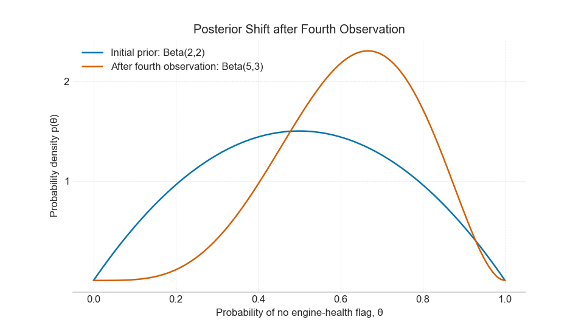
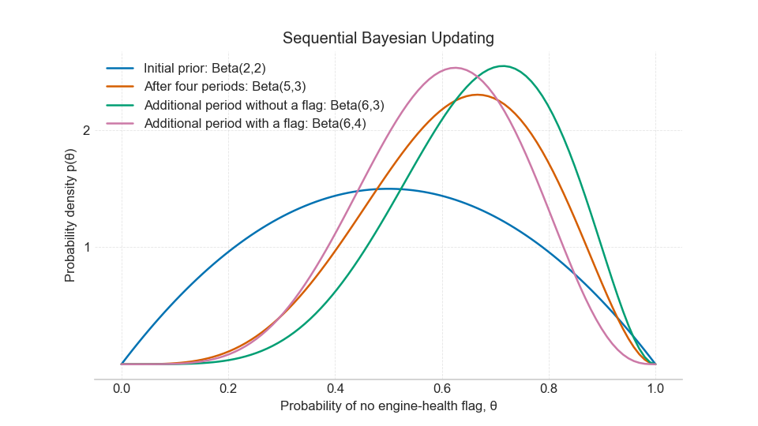
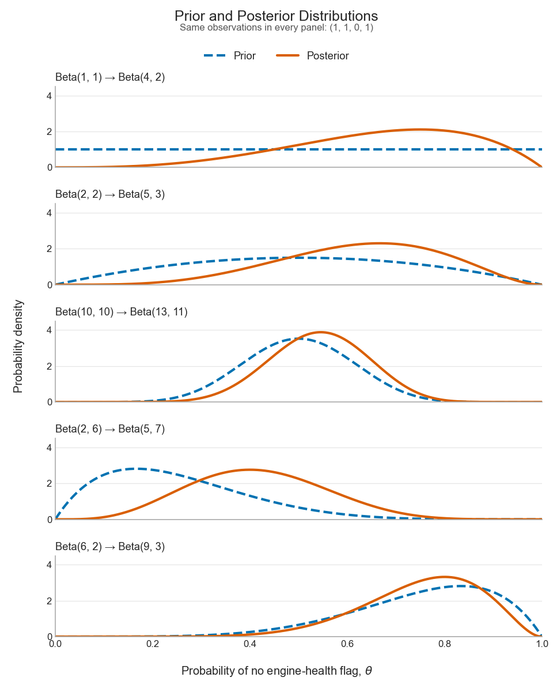

# Lecture 14 — Conjugate Priors, Prior Choice, and Prior Sensitivty 

## Introduction and guiding question

In Lecture 13, we used Bayes' rule with a Beta(2,2) prior and three observations coded 1 and one coded 0 to obtain a Beta(5,3) posterior. We now use the same binary model to study engine-health flags.

That calculation raises two practical questions. **Why did the posterior remain a Beta distribution? And where did the original values 2 and 2 come from?**

**Scenario:** We monitor an engine using a fixed sensor-based rule for raising an engine-health flag. For each monitoring period of the same duration, we record whether at least one flag was raised. We restrict attention to comparable operating conditions and assume the engine's condition and the flagging rule remain stable during the observations.

We code a period with no flag as $X_i=1$ and a period with a flag as $X_i=0$. Our unknown parameter $\theta$ is the probability of no flag during one such period. We want to update our knowledge of this probability as observations arrive. Records from other comparable engines may also help us specify a prior.

A sensor flag is an observed indicator, not a direct observation of true engine health. This model describes flag occurrence; it does not estimate the probability of a fault given sensor measurements.

> How can we choose a prior, update it efficiently as data arrive, and assess how sensitive the posterior is to that choice?

This lecture develops conjugate updating, prior specification, and prior sensitivity. It sets the stage for Lecture 15. Lecture 15 will use posterior distributions to construct credible intervals and evaluate hypotheses.

## Learning objectives

After completing this lecture, you should be able to:

1. Explain conjugacy and derive the Beta–Bernoulli posterior update.
2. Apply sequential updating and show why it agrees with batch updating under the same model.
3. Interpret the mean and concentration of a Beta prior and assess prior sensitivity.
4. Recognize several common likelihood–conjugate-prior pairs.

## 1. Conjugate priors and the Beta–Bernoulli update

### 1.1 Recap on Bayes' rule

We use the engine-monitoring scenario to connect each step of Bayesian updating to the observed data.

Let $X_i=1$ indicate that no engine-health flag was recorded during monitoring period $i$, and $X_i=0$ indicate that at least one flag was recorded. The parameter $\theta$ is the probability of a period with no flag under the specified conditions. Assume the period outcomes are conditionally independent given the same fixed $\theta$:

$$
p(X_i=x_i\mid\theta)=\theta^{x_i}(1-\theta)^{1-x_i},
\qquad x_i\in\{0,1\}.
$$

For the observed sequence $\mathcal D=(x_1,\ldots,x_N)$, define $S$ as the number of periods with no flag and $F$ as the number with a flag: 

$$
S=\sum_{i=1}^N x_i,
\qquad F=N-S.
$$

We can now write the likelihood as

$$
\mathcal L(\theta;\mathcal D)
=p(\mathcal D\mid\theta)
=\prod_{i=1}^N\theta^{x_i}(1-\theta)^{1-x_i}
=\theta^S(1-\theta)^F.
$$

For a candidate value of $\theta$, this is the probability of the observed sequence given that candidate. With the data fixed and $\theta$ varying, it is the likelihood function. The semicolon in $\mathcal L(\theta;\mathcal D)$ separates the parameter argument from the fixed data; it is not a conditional-probability symbol.

Bayes' rule gives

$$
p(\theta\mid\mathcal D)
=\frac{\mathcal L(\theta;\mathcal D)p(\theta)}{p(\mathcal D)},
\qquad
p(\mathcal D)=\int_0^1\mathcal L(\theta;\mathcal D)p(\theta)\,d\theta.
$$

| Quantity | Meaning |
|---|---|
| $p(\theta)$ | Prior density over candidate parameter values |
| $\mathcal L(\theta;\mathcal D)=p(\mathcal D\mid\theta)$ | Likelihood of the observed data as a function of the parameter |
| $p(\mathcal D)$ | Evidence, which normalizes the posterior |
| $p(\theta\mid\mathcal D)$ | Posterior density over parameter values after observing the data |

> Remember: The likelihood is not a probability distribution over $\theta$. The prior and posterior are distributions over $\theta$.

### 1.2 What makes a prior conjugate?

Now we turn to conjugacy: A prior family is **conjugate to a likelihood** when updating any prior in that family produces a posterior in the same family.

For a Bernoulli likelihood, a Beta prior produces a Beta posterior. The shape parameters change, but the distribution family stays the same. This lets us express the posterior using a small number of updated parameters, and makes computation very efficient. 

What is important: Conjugacy is a relationship between a prior family and a likelihood. It does not establish that the prior is appropriate for an application; that still depends on the assumptions it represents.

### 1.3 Derive the general update

Recall the Beta density from Lecture 13:

$$
p(\theta\mid a,b)
=\frac{1}{B(a,b)}\theta^{a-1}(1-\theta)^{b-1},
\qquad 0<\theta<1,\quad a,b>0,
$$

where

$$
B(a,b)=\int_0^1 t^{a-1}(1-t)^{b-1}\,dt
$$

is the normalizing constant. The positive numbers $a$ and $b$ are **hyperparameters**: parameters of the prior distribution for $\theta$.

Multiply the likelihood by the prior:

$$
\begin{aligned}
p(\theta\mid\mathcal D,a,b)
&\propto\theta^S(1-\theta)^F\theta^{a-1}(1-\theta)^{b-1}\\
&=\theta^{a+S-1}(1-\theta)^{b+F-1}.
\end{aligned}
$$

Compare the exponents with the Beta density. The new first shape parameter is $a+S$ and the new second shape parameter is $b+F$. Therefore,

$$
\boxed{\theta\mid\mathcal D,a,b\sim\operatorname{Beta}(a+S,b+F).}
$$

The normalized posterior density is

$$
p(\theta\mid\mathcal D,a,b)
=\frac{\theta^{a+S-1}(1-\theta)^{b+F-1}}{B(a+S,b+F)}.
$$

When $a,b$ are fixed and understood, we shorten the notation to $p(\theta\mid\mathcal D)$.

:::{admonition} The updating rule
:class: important

Each period with no flag adds one to the first Beta shape parameter. Each period with a flag adds one to the second.
:::

Using the same numerical sequence as Lecture 13, now interpreted as engine-monitoring outcomes,

$$
\mathcal D=(1,1,0,1),\qquad S=3,\quad F=1,
$$

so Beta(2,2) becomes Beta(5,3).

**Figure**  Posterior update for four outcomes $(1,1,0,1)$ - recap on Lecture 13. The two curves belong to the same family; the observations change their shape parameters.

### 1.4 Where did the evidence go?

In Section 1.3, we recognized the shape of the posterior using proportionality. We now keep all the constants and substitute the evidence into Bayes' rule to obtain the normalized density.

**Step 1: Write Bayes' rule with all four components.**

$$
\underbrace{p(\theta\mid\mathcal D,a,b)}_{\text{posterior}}
=\frac{
\underbrace{\mathcal L(\theta;\mathcal D)}_{\text{likelihood}}
\underbrace{p(\theta\mid a,b)}_{\text{prior}}
}{
\underbrace{p(\mathcal D\mid a,b)}_{\text{evidence}}
}.
$$

Here $a,b$ are fixed prior hyperparameters. For the particular observed sequence, the likelihood–prior product is

$$
\begin{aligned}
p(\mathcal D\mid\theta)p(\theta\mid a,b)
&=\theta^S(1-\theta)^F
\frac{\theta^{a-1}(1-\theta)^{b-1}}{B(a,b)}\\
&=\frac{\theta^{a+S-1}(1-\theta)^{b+F-1}}{B(a,b)}.
\end{aligned}
$$

**Step 2: Calculate the evidence by integrating this product.**

$$
\begin{aligned}
p(\mathcal D\mid a,b)
&=\int_0^1 \mathcal L(t;\mathcal D)p(t\mid a,b)\,dt\\
&=\frac{1}{B(a,b)}\int_0^1 t^{a+S-1}(1-t)^{b+F-1}\,dt\\
&=\frac{B(a+S,b+F)}{B(a,b)}.
\end{aligned}
$$

The last step uses the definition of the Beta function from Section 1.3. We use $t$ as the integration variable to distinguish it from the candidate parameter value $\theta$ in the posterior density. The evidence is a number for the fixed data and prior hyperparameters; it does not depend on $\theta$.

**Step 3: Substitute the evidence and simplify.**

$$
\begin{aligned}
p(\theta\mid\mathcal D,a,b)
&=\frac{
\displaystyle \frac{\theta^{a+S-1}(1-\theta)^{b+F-1}}{B(a,b)}
}{
\displaystyle \frac{B(a+S,b+F)}{B(a,b)}
}\\[6pt]
&=\frac{\theta^{a+S-1}(1-\theta)^{b+F-1}}{B(a,b)}
\frac{B(a,b)}{B(a+S,b+F)}\\[6pt]
&=\frac{\theta^{a+S-1}(1-\theta)^{b+F-1}}{B(a+S,b+F)}.
\end{aligned}
$$

Dividing by the evidence means multiplying by its reciprocal. The factor $B(a,b)$ then cancels, leaving the normalizing factor $1/B(a+S,b+F)$. This is exactly the Beta$(a+S,b+F)$ density.

:::{admonition} What cancels, and what remains, and why the computation becomes simplier! 
:class: important

The **prior's normalizing factor** cancels with the matching factor in the evidence. The evidence itself is not simply discarded: dividing by it produces the normalized posterior. The likelihood remains incorporated in the updated exponents through $S$ and $F$.
**What do we actually calculate in the next update?** Once we have established the conjugate updating rule, obtaining the posterior requires only counting the observations and updating two parameters:

$$
a_{\mathrm{post}}=a+S,
\qquad
b_{\mathrm{post}}=b+F.
$$

For our example,

$$
a_{\mathrm{post}}=2+3=5,
\qquad
b_{\mathrm{post}}=2+1=3.
$$

We can therefore write the full posterior immediately:

$$
\theta\mid\mathcal D\sim\operatorname{Beta}(5,3).
$$

If we need its density explicitly, we use the known Beta normalizing
constant:

$$
p(\theta\mid\mathcal D)
=\frac{\theta^4(1-\theta)^2}{B(5,3)}
=105\theta^4(1-\theta)^2,
\qquad 0<\theta<1.
$$

We do not need to calculate the evidence separately merely to identify
this normalized posterior. 

If we need the evidence itself, it is also available:

$$
p(\mathcal D\mid a=2,b=2)
=\frac{B(5,3)}{B(2,2)}
=\frac{1/105}{1/6}
=\frac{2}{35}.
$$

Conjugacy therefore gives us both a simple parameter update and a known
normalization formula. It does not remove the evidence from Bayes' rule;
it lets us account for normalization without repeating the integral
calculation from scratch.
:::

### 1.5 Connection to sufficient statistics

The likelihood depends on the sequence through $S$ and $F$. For known $N$, knowing $S$ also determines $F$. Thus $S$ is sufficient for $\theta$ in this Bernoulli model. So that is why we covered sufficient statistics in Lecture 12. 

> Note: For example, $(1,1,0,1)$ and $(0,1,1,1)$ produce the same posterior from the same prior. Order does not change the likelihood under the shared-parameter, conditionally independent model. If the flag probability changes over time or outcomes remain dependent given $\theta$, we need a different model.

**Textbook reference for more details:** Bishop, §§2.1.1 and 2.4.2; sufficient statistics in §2.4.1.

## 2. Bayesian learning as a sequential process

### 2.1 The posterior becomes the next prior

We now collect additional engine-monitoring observations over time. Suppose we have already analyzed $\mathcal D_{\mathrm{old}}$ and then observe $\mathcal D_{\mathrm{new}}$. Under conditional independence of the batches given $\theta$,

$$
p(\theta\mid\mathcal D_{\mathrm{old}},\mathcal D_{\mathrm{new}})
\propto \mathcal L(\theta;\mathcal D)
\,p(\theta\mid\mathcal D_{\mathrm{old}}).
$$

The current posterior summarizes what we have learned about the same parameter. It supplies the prior distribution for the next update. The new likelihood contains only the new observations.

### 2.2 Illustrative example (continuing the drone/engine example)

After the first four monitoring periods, let $\mathcal D_4=(1,1,0,1)$. The posterior is Beta(5,3), with density proportional to $\theta^4(1-\theta)^2$.

No flag is recorded in the fifth period, so $X_5=1$. The new likelihood is

$$
\mathcal L(\theta;X_5=1)=p(X_5=1\mid\theta)=\theta.
$$

Multiplying it by the previous posterior gives

$$
\begin{aligned}
\underbrace{p(\theta\mid\mathcal D_4,X_5=1)}_{\text{new posterior}}
&\propto
\underbrace{\theta}_{\text{new likelihood}}
\underbrace{\theta^4(1-\theta)^2}_{\text{previous posterior, up to normalization}}\\
&=\theta^5(1-\theta)^2.
\end{aligned}
$$

After normalization, this is Beta(6,3). The likelihood contributes the extra power of $\theta$; it has not disappeared. The proportionality sign leaves the normalizing constant implicit, as in Section 1.3.

A flag is then recorded in the sixth period. Its likelihood is $p(X_6=0\mid\theta)=1-\theta$, so multiplying by the current Beta(6,3) density produces a density proportional to $\theta^5(1-\theta)^3$. After normalization, this is Beta(6,4).

The sequence of updates is therefore:

$$
\operatorname{Beta}(5,3)
\xrightarrow{X_5=1}\operatorname{Beta}(6,3)
\xrightarrow{X_6=0}\operatorname{Beta}(6,4).
$$

| Information incorporated | Cumulative periods without a flag | Cumulative periods with a flag | Distribution for $\theta$ |
|---|---:|---:|---|
| Before monitoring begins | 0 | 0 | Beta(2,2) |
| First four outcomes $(1,1,0,1)$ | 3 | 1 | Beta(5,3) |
| Additional period without a flag $(1,1,0,1,1)$ | 4 | 1 | Beta(6,3) |
| Additional period with a flag $(1,1,0,1,1,0)$ | 4 | 2 | Beta(6,4) |

Counts are cumulative. Each row shows the distribution after incorporating all outcomes listed in that row. The first row is the original prior; each subsequent row is a posterior that becomes the prior for the next update.

**Figure caption:** Sequential Bayesian updating. Starting from Beta(2,2), three periods without a flag and one with a flag yield Beta(5,3). An additional period without a flag gives Beta(6,3); a subsequent period with a flag gives Beta(6,4). Each update multiplies the current density by the likelihood of the new observation and normalizes the result. Label the axes “Probability of no engine-health flag, $\theta$” and “Probability density.”

### 2.3 Why sequential and batch updates agree

Updating once with all six observations gives

$$
\operatorname{Beta}(2+4,2+2)=\operatorname{Beta}(6,4).
$$

More generally, batches with counts $(S_1,F_1)$ and $(S_2,F_2)$ give

$$
\operatorname{Beta}(a+S_1+S_2,b+F_1+F_2).
$$

The additions give the same result regardless of the grouping or order of observations. 
**Important**: This holds when both calculation routes start from the same original prior and use the same model with a fixed parameter $\theta$.

:::{warning}
When the current posterior becomes the next prior, do not multiply by the likelihood of the old data again. Their information is already included in that posterior.
:::

## 3. Choosing a Beta prior and checking sensitivity

### 3.1 What should the prior represent?

A prior describes uncertainty about $\theta$ before incorporating the data used in the current likelihood. It may reflect engineering knowledge, previous comparable experiments, or a deliberately broad starting assumption.

Comparability matters. Results obtained with different hardware, weather, or definitions of the flagging rule may not describe the parameter we are studying. A convenient mathematical prior still needs a substantive justification.

### 3.2 Mean and concentration

For a Beta distribution,

$$
\mathbb E[\theta]=\frac{a}{a+b},
\qquad
\operatorname{Var}(\theta)=\frac{ab}{(a+b)^2(a+b+1)}.
$$

A useful way to specify it is through its mean $m$ and concentration $\kappa$:

$$
m=\frac{a}{a+b},\qquad \kappa=a+b.
$$

Then

$$
a=m\kappa,\qquad b=(1-m)\kappa,
\qquad
\operatorname{Var}(\theta)=\frac{m(1-m)}{\kappa+1}.
$$

The mean locates the prior's center of mass. At fixed mean, a larger concentration gives a smaller variance. Neither quantity is an observed monitoring-period outcome.

| Prior | Mean $m$ | Concentration $\kappa$ | Interpretation |
|---|---:|---:|---|
| Beta(1,1) | 0.50 | 2 | Uniform density on $(0,1)$ |
| Beta(2,2) | 0.50 | 4 | Symmetric, with more density near the center |
| Beta(10,10) | 0.50 | 20 | More concentrated around 0.50 |
| Beta(2,6) | 0.25 | 8 | Center of mass toward lower probabilities of no flag |
| Beta(6,2) | 0.75 | 8 | Center of mass toward higher probabilities of no flag |

For example, a chosen mean of 0.7 and concentration of 10 give $a=7$, $b=3$. A mean alone does not specify a Beta prior; we also need its concentration or another measure of spread.

Although the update adds counts to $a$ and $b$, prior shape parameters need not be integers or represent literal historical observations. Likewise, a uniform density in $\theta$ does not imply a uniform density after a nonlinear change of parameter.

### 3.3 Hold the observations fixed and vary the prior

Return to the original four outcomes $(1,1,0,1)$. Do not include the two additional monitoring periods from Section 2 in this comparison.

| Illustrative prior | Posterior after three periods with no flag and one with a flag |
|---|---|
| Beta(1,1) | Beta(4,2) |
| Beta(2,2) | Beta(5,3) |
| Beta(10,10) | Beta(13,11) |
| Beta(2,6) | Beta(5,7) |
| Beta(6,2) | Beta(9,3) |

Every row uses the same likelihood. Differences between posterior curves therefore arise from the prior assumptions. With four observations, those assumptions can have a substantial effect.

**Figure caption:** Effect of prior choice with the observations held fixed at $(1,1,0,1)$. Each panel shows a prior (dashed blue) and its posterior (solid orange), using common horizontal and vertical scales. Differences between the posteriors reflect different prior assumptions. Label the axes “Probability of no engine-health flag, $\theta$” and “Probability density.” 

### 3.4 Explain the relative influence of prior and data

The posterior mean provides one simple way to describe the center of each curve:

$$
\begin{aligned}
\mathbb E[\theta\mid\mathcal D]
&=\frac{a+S}{a+b+N}\\
&=\frac{\kappa}{\kappa+N}m
+\frac{N}{\kappa+N}\frac{S}{N},\qquad N>0.
\end{aligned}
$$

It is a weighted average of the prior mean and the observed proportion of periods with no flag. For the Beta(2,2) example,

$$
\mathbb E[\theta\mid\mathcal D]
=\frac48\left(\frac12\right)+\frac48\left(\frac34\right)
=\frac58.
$$

For fixed $\kappa$, the prior's weight decreases as $N$ increases. This describes the center of the posterior; the full posterior also represents uncertainty around it. We are not introducing an optimization rule or replacing the distribution with a single estimate.

A prior-sensitivity analysis compares scientifically plausible priors using the same data. If the resulting distributions differ substantially, report that dependence rather than selecting a prior to obtain a preferred answer. Lecture 15 will extend the comparison to intervals and hypothesis probabilities.

## 4. Other conjugate families, and benefits and limits of conjugacy

### 4.1 Overview
Conjugacy also occurs in other familiar sampling models. The table gives an overview. Above, we have used the Beta–Bernoulli model as an example. We encourage you to explore other priors as well as you advance your statistical knowledge about the update process without the need to compute the evidence. However, for this class, we will primarily use Beta–Bernoulli model for illustration purposes. 

| Sampling model | Unknown parameter | Conjugate prior | Posterior update |
|---|---|---|---|
| Bernoulli or Binomial | $\theta=P(X=1)$ | Beta$(a,b)$ | Beta$(a+S,b+F)$ |
| Categorical or Multinomial | Category-probability vector $\boldsymbol\theta$ | Dirichlet$(\alpha_1,\ldots,\alpha_K)$ | Dirichlet with updated alpha |
| Poisson, equal unit observation periods | Event rate $\lambda$ | Gamma$(a,b)$, shape–rate convention | Gamma$(a+\sum_i x_i,b+N)$ |
| Normal, known observation variance $\sigma^2$ | Mean $\mu$ | Normal$(m_0,\tau_0^2)$ | Normal with updated mean and variance |

## Summary

Conjugacy makes Bayesian updating easier to calculate and repeat: the posterior belongs to the same distribution family as the prior.
Its main benefits are:

1. An explicit posterior formula. 
2. Straightforward normalization. (e.g. once we recognize the posterior as a Beta distribution, its known normalizing constant gives the normalized density. We do not need to calculate a new integral from scratch for every update.) 
3. Clear interpretation. The updating formula makes it easy to see how prior assumptions and observed data combine, and to compare results under different priors.

However, there are a few things to keep in mind: 
1. Conjugacy provides computational convenience, not a guarantee that the prior is appropriate. The prior must still represent reasonable assumptions about the unknown parameter. 
2. Also, sequential updating is possible without conjugacy; conjugacy makes the calculations particularly simple
3. Conjugacy provides a convenient analytic update. It does not determine the correct likelihood, select prior hyperparameters, or check whether observations satisfy the model assumptions.

> Keep in mind that Bayes' rule also applies to nonconjugate priors. The posterior may then require numerical integration or another approximation. Choosing an appropriate prior and computing its posterior are separate tasks.

**Textbook reference for more details:** Bishop §2.1.1 for Beta priors, §2.2 for the Dirichlet family, §2.3.6 for inference on Gaussian parameters, and §2.4.2 for general conjugacy.

In Lecture 15, we will use these posterior distributions to construct credible intervals, calculate probabilities for parameter hypotheses, and interpret Bayes factors.

## Practice examples 

### 1. Sequential versus batch updating

Start with Beta(2,2). Observe $(1,1,0,1)$, followed by $(1,0)$.

1. Find the posterior after each batch.
2. Calculate the posterior using all six observations at once.
3. Explain why the answers agree.

::::{admonition} Solution 1
:class: dropdown

The first batch contains three periods with no flag and one with a flag, giving Beta(5,3). The second batch adds one period with no flag and one with a flag, giving Beta(6,4).

All six observations contain four periods with no flag and two with a flag. A batch update gives Beta$(2+4,2+2)=$ Beta(6,4). The conditionally independent likelihood factors across batches, and both approaches include every observation once.
::::

### 2. Specify a Beta prior

Choose a prior mean of 0.8 and concentration 5. Then observe two periods with no flag and one with a flag.

1. Find $a,b$ and the posterior parameters.
2. Repeat with concentration 20 and the same prior mean.
3. Explain which prior gives its mean greater weight in the posterior mean.

::::{admonition} Solution 2
:class: dropdown

With $\kappa=5$, $a=4$ and $b=1$. The posterior is Beta(6,2).

With $\kappa=20$, $a=16$ and $b=4$. The posterior is Beta(18,5).

The prior-mean weights are $5/(5+3)$ and $20/(20+3)$, respectively. The higher concentration gives the prior mean more weight. The posterior means are $6/8=0.75$ and $18/23\approx0.783$.
::::

### 3. Sequence likelihood and count likelihood

With a Beta(1,1) prior, compare observing the particular sequence $(1,0,1)$ with observing only that two of three monitoring periods had no flag.

1. Write both likelihoods.
2. Find the evidence for each observation.
3. Explain why the posteriors agree.

::::{admonition} Solution 3
:class: dropdown

The sequence likelihood is $\theta^2(1-\theta)$. The count likelihood is $\binom32\theta^2(1-\theta)=3\theta^2(1-\theta)$.

The sequence evidence is

$$
\int_0^1\theta^2(1-\theta)\,d\theta=\frac1{12}.
$$

The count evidence is $3/12=1/4$. In both cases, normalization gives $12\theta^2(1-\theta)$, the Beta(3,2) density. The extra factor is constant in $\theta$ and cancels.
::::

## Readings and references

### Primary textbook

Bishop, C. M. (2006). *Pattern Recognition and Machine Learning*. Springer. [Official textbook PDF](https://www.microsoft.com/en-us/research/wp-content/uploads/2006/01/Bishop-Pattern-Recognition-and-Machine-Learning-2006.pdf).

- **§2.1.1:** Beta priors and Bernoulli updating. Focus on Equations (2.13)–(2.18) and Figure 2.3; prediction is outside this lecture's scope.
- **§2.4.1:** sufficient statistics, reviewing Lecture 12.
- **§2.4.2:** the general idea of conjugate priors.
- **Optional §2.2 and §2.3.6:** other conjugate families represented in Section 4.
- **Optional §2.4.3:** noninformative priors and parameterization.

Bishop uses $\mu$ for the Bernoulli parameter in §2.1.1; this lecture retains $\theta$ from Lecture 13. The underlying Beta update is the same. The simple empirical Bayes example here is a teaching extension, not a worked example attributed to Bishop's Beta section.

### Supplemental reading

Johnson, A. A., Ott, M. Q., and Dogucu, M. (2022). *Bayes Rules! An Introduction to Applied Bayesian Modeling*. Chapman & Hall/CRC. [Chapter 4: Balance and Sequentiality in Bayesian Analyses](https://www.bayesrulesbook.com/chapter-4.html). Use §§4.1–4.3 for prior influence and §4.4 for sequential updating.

### Accompanying video

Steve Brunton, [*Bayesian Updates and Conjugate Priors*](https://www.youtube.com/watch?v=GqSX-8AQL90).

