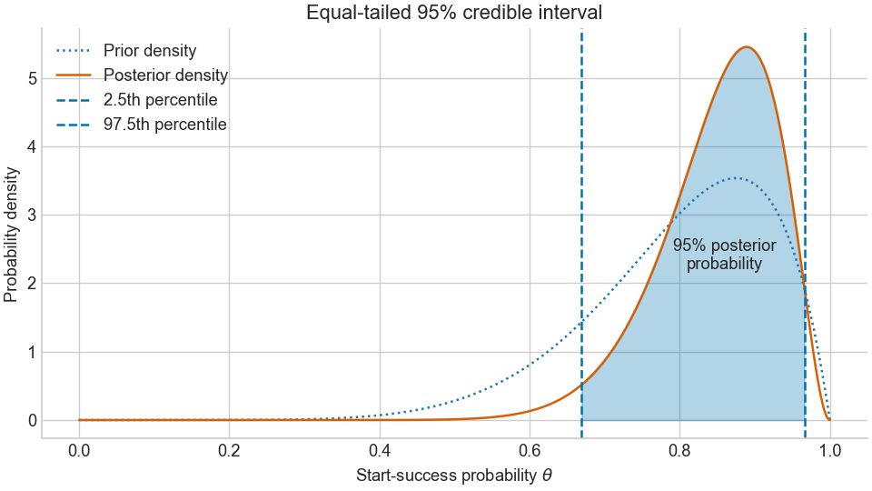
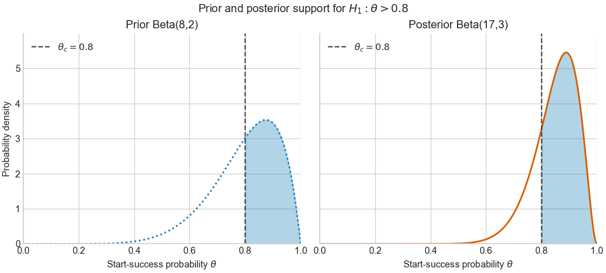

# Lecture 15 — Bayesian Hypotheses Testing

In Lecture 14, we learned how conjugate priors simplify Bayesian updating and how prior assumptions affect the posterior distribution.

In this lecture, we use the posterior to summarize uncertainty with credible intervals and evaluate hypotheses about an unknown parameter.
We then compare these Bayesian interpretations with confidence intervals and the frequentist hypothesis tests introduced earlier in the course.

:::{admonition} Scenario: Engine-start testing

We repeatedly test an engine under a defined protocol, with comparable temperature, battery condition, and starting procedure. For each attempt, we record whether the engine starts in less than five seconds.

We code a successful start as $X_i=1$ and an unsuccessful start as $X_i=0$. Given the unknown parameter $\theta$, each outcome follows a Bernoulli distribution:

$$
X_i\mid\theta\sim\operatorname{Bernoulli}(\theta),
\qquad
P(X_i=1\mid\theta)=\theta.
$$

Thus, $\theta$ is the probability that the engine starts in less than five seconds under the specified testing conditions. Assume that test outcomes are conditionally independent given the same fixed $\theta$.

For this teaching example, we set the target at $\theta_c=0.8$; this is an illustrative requirement, not an externally established engineering standard.

:::

So this leads to the following practically motivated question:
**Guiding question:** What do your test results tell you about the engine's unknown start-success probability, and how much support do they provide for the claim that it exceeds your threshold?

## Key learning outcomes

After completing Lecture 15, you should be able to:

1. Calculate and interpret an equal-tailed credible interval.
2. Distinguish a Bayesian credible interval from a frequentist confidence interval.
3. Calculate posterior probabilities for hypotheses about a parameter threshold.
4. Calculate and interpret prior odds, posterior odds, and a Bayes factor.
5. Contrast Bayesian hypothesis probabilities with frequentist p-values.
6. Examine how prior assumptions affect credible intervals and hypothesis comparisons.

## 1. Credible intervals for the unknown parameter

### 1.1 Probability as area under the posterior

For our engine-start example, suppose prior knowledge is represented by

$$
\theta\sim\operatorname{Beta}(8,2).
$$

This prior has mean $8/(8+2)=0.8$. Its mean represents our prior
expectation, whereas the benchmark $\theta_c=0.8$ represents a
performance requirement. Their equality is a choice for this example;
a requirement does not determine the prior.

Now assume that we observe ten attempts: nine successful starts and one unsuccessful start. Using the conjugate update from Lecture 14 gives

$$
\theta\mid\mathcal D
\sim\operatorname{Beta}(8+9,2+1)
=\operatorname{Beta}(17,3).
$$

The posterior density is

$$
p(\theta\mid\mathcal D)
=\frac{\theta^{16}(1-\theta)^2}{B(17,3)},
\qquad 0<\theta<1.
$$

This density describes our uncertainty about the unknown start-success
probability. The probability assigned to a range of parameter values
is the area under the posterior density over that range:

$$
P(l\leq\theta\leq u\mid\mathcal D)
=\int_l^u p(\theta\mid\mathcal D)\,d\theta.
$$

Here $l$ and $u$ are the lower and upper interval boundaries.
The curve height is a density; the area between the boundaries
is a probability. We next choose these boundaries so that the interval contains 95% of the posterior probability.

### 1.2 Construct an equal-tailed 95% credible interval

A quantile identifies a value below which a specified amount of
probability lies. You may recognize this idea from percentiles in
standardized test scores. Here, we apply it to the posterior
distribution of the unknown parameter $\theta$.

The posterior quantile $q_r$ satisfies

$$
P(\theta\leq q_r\mid\mathcal D)=r.
$$

For example, $q_{0.025}$ is a parameter value with 2.5% of the
posterior probability below it. The number $0.025$ specifies an
area under the posterior curve; it does not mean that $\theta=0.025$.

To construct an **equal-tailed 95% credible interval**, we retain
the middle 95% of the posterior probability and leave 2.5% in
each tail.

We therefore choose

$$
l=q_{0.025},
\qquad
u=q_{0.975}.
$$

These boundaries satisfy

$$
P(\theta<l\mid\mathcal D)=0.025,
\qquad
P(\theta>u\mid\mathcal D)=0.025.
$$

The posterior probability between them is consequently

$$
P(l\leq\theta\leq u\mid\mathcal D)
=0.975-0.025
=0.95.
$$

For our Beta(17,3) posterior, we calculate the boundaries numerically.
SciPy's `ppf` function returns the parameter values corresponding
to the requested cumulative probabilities:

```python
from scipy import stats

lower, upper = stats.beta.ppf([0.025,0.975],a=17,b=3)
print(f"95% credible interval: [{lower:.3f},{upper:.3f}]")
```
The inputs `0.025` and `0.975` are cumulative probabilities. The outputs `lower` and `upper` are possible values of the engine's start-success probability $\theta$.


### 1.3 Interpret the result

For our Beta(17,3) posterior, the equal-tailed 95% credible interval
is approximately $[0.669,0.966]$.

Given the observed data, prior, and sampling model, we assign 95% posterior probability to the engine's unknown start-success probability lying between these bounds.

This describes uncertainty about $\theta$. It does not mean that 95% of future engine starts will succeed.



**Figure 1**: Equal-tailed 95% credible interval of the posterior distribution based on a Beta prior (8,2) and measuring 9 successes and 1 failure.

### 1.4 Credible intervals versus confidence intervals

Both intervals summarize uncertainty about an unknown parameter,
but the probability statements have different meanings.

| Aspect | Bayesian credible interval | Frequentist confidence interval |
|---|---|---|
| Basis | Posterior distribution of $\theta$ given the observed data | Sampling distribution of a statistic under repeated sampling |
| Treatment of $\theta$ | Uncertainty about $\theta$ is represented by a probability distribution | $\theta$ is fixed but unknown |
| Role of the prior | Uses a specified prior together with the likelihood | Does not require a Bayesian prior |
| Meaning of 95% | Given the data and Bayesian model, the interval contains 95% of the posterior probability for $\theta$ | Over repeated samples, a procedure with 95% coverage produces intervals containing the fixed $\theta$ 95% of the time |
| Engine-start interpretation | “Given our observations, prior, and sampling model, we assign 95% probability to $\theta$ lying between these bounds.” | “If we repeatedly collected test data and constructed intervals using this procedure, 95% of those intervals would contain the true start-success probability.” |
| What the interval does not say | It does not mean that 95% of future engine starts will succeed | It does not, by itself, assign 95% probability to $\theta$ lying inside the particular observed interval |

For a 95% credible interval, the probability statement is

$$
P(l\leq\theta\leq u\mid\mathcal D)=0.95.
$$

For a confidence-interval procedure with exact 95% coverage,
the statement is

$$
P_\theta\!\left(
L(\mathcal D)\leq\theta\leq U(\mathcal D)
\right)=0.95.
$$

In the second expression, the probability refers to repeated datasets
$\mathcal D$. The endpoints $L(\mathcal D)$ and $U(\mathcal D)$ vary
from sample to sample, while $\theta$ remains fixed. As discussed in
Lecture 9, some confidence-interval procedures have approximate or
conservative coverage rather than exactly 95%.

:::{admonition} The key distinction
:class: important

A credible interval assigns posterior probability to a parameter
range after observing the data. A confidence level describes the
repeated-sampling coverage of the method used to construct the interval.

The two intervals can have similar numerical endpoints without
having the same interpretation.
:::


## 2. Bayesian hypothesis testing about a threshold

A credible interval fixes the posterior probability and finds
corresponding interval boundaries. We now reverse the question:
we specify a parameter region and calculate its posterior probability.

For our engine-start example, we ask:

> Given the test results, how much posterior probability do we assign
> to the claim that the start-success probability exceeds 0.8?

### 2.1 Stating the complementary hypotheses

Using the benchmark $\theta_c=0.8$ specified in our scenario, we define

$$
H_0:\theta\leq0.8,
\qquad
H_1:\theta>0.8.
$$

- $H_0$: the start-success probability does not exceed the benchmark.
- $H_1$: the start-success probability exceeds the benchmark.

The hypotheses cover all possible parameter values and do not overlap.
Their probabilities therefore sum to one.

The benchmark is a requirement chosen before examining the data.
It is not a posterior quantile or a critical value of a test statistic.

### 2.2 Posterior hypothesis probabilities

From Section 1, our posterior is

$$
\theta\mid\mathcal D\sim\operatorname{Beta}(17,3).
$$

The posterior probability of $H_1$ is the area above the benchmark:

$$
P(H_1\mid\mathcal D)
=P(\theta>0.8\mid\mathcal D)
=\int_{0.8}^{1}p(\theta\mid\mathcal D)\,d\theta.
$$

The remaining probability belongs to $H_0$:

$$
P(H_0\mid\mathcal D)
=P(\theta\leq0.8\mid\mathcal D)
=1-P(H_1\mid\mathcal D).
$$

We can calculate these probabilities using SciPy:

```python
from scipy import stats

threshold = 0.8
prior = stats.beta(a=8, b=2)
posterior = stats.beta(a=17, b=3)

post_h0 = posterior.cdf(threshold)
post_h1 = posterior.sf(threshold)

print(f"P(H0 | data) = {post_h0:.3f}")
print(f"P(H1 | data) = {post_h1:.3f}")
```

Here `cdf` gives the probability at or below the threshold.
The survival function `sf` gives the probability above it.

The results are

$$
P(H_1\mid\mathcal D)\approx0.763,
\qquad
P(H_0\mid\mathcal D)\approx0.237.
$$

Given the observed data, prior, and sampling model, we assign
approximately 76.3% posterior probability to the claim that
the engine's start-success probability exceeds 0.8.

This is a probability about the unknown parameter. It is not a
frequentist p-value or the probability that the next start succeeds.

### 2.3 Compare prior and posterior odds

The posterior incorporates both the prior and the observations.
To understand what changed, first calculate the prior probabilities:

$$
P(H_1)=\int_{0.8}^{1}p(\theta)\,d\theta\approx0.564,
$$

$$
P(H_0)=1-P(H_1)\approx0.436.
$$

Although the Beta(8,2) prior has mean 0.8, its probability above
0.8 is not exactly one-half. The mean need not be the median.

Odds compare the probability of one hypothesis with that of the other.
The subscript $10$ means that we place $H_1$ in the numerator:

$$
O_{10}^{\mathrm{prior}}
=\frac{P(H_1)}{P(H_0)}
\approx1.292,
$$

$$
O_{10}^{\mathrm{post}}
=\frac{P(H_1\mid\mathcal D)}{P(H_0\mid\mathcal D)}
\approx3.221.
$$

Before testing, the odds favored $H_1$ by about 1.29 to 1.
After testing, they favor $H_1$ by about 3.22 to 1.

### 2.4 Bayes factor

Now we can ask: **How much did the observations change these odds?**
The Bayes factor measures this change. To derive it, apply Bayes'
rule separately to the two hypotheses:

$$
P(H_j\mid\mathcal D)
=
\frac{p(\mathcal D\mid H_j)P(H_j)}{p(\mathcal D)},
\qquad j\in\{0,1\}.
$$

Taking their ratio cancels the common evidence $p(\mathcal D)$:

$$
\frac{P(H_1\mid\mathcal D)}{P(H_0\mid\mathcal D)}
=
\frac{p(\mathcal D\mid H_1)}{p(\mathcal D\mid H_0)}
\frac{P(H_1)}{P(H_0)}.
$$

The left-hand side is the posterior odds. On the right-hand side,
the prior odds are multiplied by a ratio of hypothesis-specific
evidences. This ratio is the **Bayes factor**:

$$
\mathrm{BF}_{10}
=
\frac{p(\mathcal D\mid H_1)}{p(\mathcal D\mid H_0)}.
$$

Therefore,

$$
O_{10}^{\mathrm{post}}
=
\mathrm{BF}_{10}\,O_{10}^{\mathrm{prior}},
$$

and we can calculate the Bayes factor directly from the odds:

$$
\boxed{
\mathrm{BF}_{10}
=
\frac{O_{10}^{\mathrm{post}}}{O_{10}^{\mathrm{prior}}}.
}
$$

For our engine-start example,

$$
\mathrm{BF}_{10}
=
\frac{3.22138}{1.29249}
\approx2.49.
$$

The observations multiply the prior odds of $\theta>0.8$ by
approximately 2.49.

- $\mathrm{BF}_{10}>1$: the observations increase the odds of $H_1$
  relative to $H_0$.
- $\mathrm{BF}_{10}<1$: the observations decrease those odds.
- $\mathrm{BF}_{10}=1$: the odds remain unchanged.

A Bayes factor measures a change in odds, not a posterior probability.
Here, $\mathrm{BF}_{10}\approx2.49$, while
$P(H_1\mid\mathcal D)\approx0.763$.

**Textbook connection:** Bayes Rules!, Section 8.2.1, calculates the
Bayes factor using posterior and prior odds. Bishop (2006),
Section 3.4, defines it as a ratio of model evidences. The derivation above shows why these expressions agree.

### 2.5 Worked example: What did the engine tests change?

Calculate the prior probabilities, odds, and Bayes factor:

```python
prior_h0 = prior.cdf(threshold)
prior_h1 = prior.sf(threshold)

prior_odds = prior_h1 / prior_h0
posterior_odds = post_h1 / post_h0
bayes_factor = posterior_odds / prior_odds

print(f"Prior odds: {prior_odds:.3f}")
print(f"Posterior odds: {posterior_odds:.3f}")
print(f"Bayes factor BF10: {bayes_factor:.3f}")
```

| Quantity | Before observing the tests | After observing the tests |
|---|---:|---:|
| Probability of $H_1:\theta>0.8$ | 0.564 | 0.763 |
| Probability of $H_0:\theta\leq0.8$ | 0.436 | 0.237 |
| Odds of $H_1$ relative to $H_0$ | 1.292 | 3.221 |

Thus,

$$
\mathrm{BF}_{10}
=\frac{3.22138}{1.29249}
\approx2.49.
$$

The nine successful starts and one unsuccessful start multiply
the prior odds of exceeding the benchmark by approximately 2.49.

The posterior favors $H_1$, but approximately 23.7% posterior
probability remains on $H_0$. The observations have increased
support for exceeding the benchmark without establishing certainty.



**Figure 2:** Beta(8,2) prior (left) and Beta(17,3) posterior (right).
Shading marks $\theta>0.8$. Its probability increases from 0.564
before observing the tests to 0.763 after nine successful starts
and one unsuccessful start.


### 2.6 Interpretation, sensitivity, and decisions

Three quantities answer different questions:

| Quantity | Question answered |
|---|---|
| Posterior probability | Given the observations, prior, and sampling model, how probable is the claim that $\theta>0.8$? |
| Bayes factor | By what factor did the observations change the prior odds of that claim? |
| Decision rule | What action should we take, considering uncertainty and the consequences of each action? |

In our example, the posterior probability of exceeding the benchmark
is approximately 0.763. The Bayes factor is approximately 2.49:
the observations multiply the prior odds of exceeding the benchmark
by this factor.

Neither number alone specifies whether to approve the engine, inspect it, or collect additional observations. That decision also depends on the consequences of approving an engine whose start-success probability does not meet the requirement.

### 2.7 Bayesian and frequentist hypothesis testing

Consider the same hypotheses:

$$
H_0:\theta\leq0.8,
\qquad
H_1:\theta>0.8.
$$

The Bayesian analysis calculates probabilities for these parameter
regions using the posterior distribution.

A frequentist test instead asks how unusual the observed result,
or a more extreme result, would be under the null hypothesis.

#### A frequentist test using the same observations

As in our earlier frequentist tests, we first choose a sample statistic and determine its sampling distribution under the null hypothesis.
Here, our test statistic is the total number of successful starts,

$$
S=\sum_{i=1}^{10}X_i.
$$

Its observed value is $S_{\mathrm{obs}}=9$.

> Because the outcomes are independent Bernoulli observations under
a fixed $\theta$, we know the exact sampling distribution of $S$:
it is binomial. We do not need a Z- or t-statistic.

We also know that our samples are conditionally independent.
Thus, under a  conditionally independent Bernoulli model,

$$
S\mid\theta\sim\operatorname{Binomial}(10,\theta).
$$

We observed $S=9$. Larger success counts favor $H_1$, so the relevant
tail consists of nine or ten successful starts.

For the composite null $\theta\leq0.8$, this tail probability is
largest at the boundary $\theta=0.8$. The one-sided p-value is

$$
\begin{aligned}
\text{p-value}
&=\sup_{\theta\leq0.8}P_\theta(S\geq9)\\
&=P_{\theta=0.8}(S\geq9)\\
&=\binom{10}{9}(0.8)^9(0.2)+(0.8)^{10}\\
&\approx0.376.
\end{aligned}
$$

In Python:

```python
from scipy import stats

# sf(8) gives P(S > 8), which equals P(S >= 9).
p_value = stats.binom.sf(8, n=10, p=0.8)
print(f"One-sided p-value: {p_value:.3f}")
```

At a significance level of $\alpha=0.05$, we do not reject $H_0$.
This does not establish that $H_0$ is true.

#### What do the numbers mean?

| Quantity | Result | Interpretation |
|---|---:|---|
| Posterior probability of $H_1$ | 0.763 | Given the observations, prior, and model, we assign 76.3% probability to $\theta>0.8$. |
| Bayes factor $\mathrm{BF}_{10}$ | 2.49 | The observations multiply the prior odds of $H_1$ relative to $H_0$ by approximately 2.49. |
| Frequentist p-value | 0.376 | At the null boundary $\theta=0.8$, the probability of observing nine or more successful starts out of ten is approximately 37.6%. |

The posterior favors $H_1$, while the frequentist test does not reject
$H_0$ at the 5% level. These statements answer different questions
and do not contradict each other.

:::{admonition} A p-value is not a hypothesis probability
:class: important

The p-value is not $P(H_0\mid\mathcal D)$, and one minus the p-value
is not $P(H_1\mid\mathcal D)$.

A p-value concerns possible observations under the null hypothesis.
A posterior hypothesis probability concerns parameter values given
the observed data and a specified Bayesian model.
:::

## 3. Summary

Our analysis began with a Beta(8,2) prior and nine successful starts
in ten attempts. Conjugacy gave the Beta(17,3) posterior. We then
used that posterior to answer two different questions:

- Which interval contains 95% of the posterior probability?
- How much posterior probability lies above the benchmark $\theta_c=0.8$?

| Tool | Question answered | Main requirement |
|---|---|---|
| Conjugate update | What is the posterior after observing the data? | A conjugate prior–likelihood pair |
| Sequential update | How do we incorporate additional observations? | A shared parameter and the appropriate new-data likelihood; each observation counted once |
| Prior-sensitivity analysis | How do conclusions change under alternative priors? | Hold the observations and sampling model fixed |
| Credible interval | Which parameter interval contains a specified posterior probability? | A posterior distribution and an interval-construction rule |
| Posterior hypothesis probability | How probable is a specified parameter region after observing the data? | Explicit hypotheses and a posterior distribution |
| Bayes factor | How much do the observations change the relative odds of the hypotheses? | Specified conditional priors within the hypotheses |
| Frequentist p-value | How unusual is the observed statistic, or a more extreme value, under the null? | A null sampling distribution and a definition of “more extreme” |

Conjugacy makes the posterior update analytic. We may still use
numerical functions to calculate posterior quantiles and areas.

**Closing question:** Before recommending an action, what would you
report alongside the statement that the posterior probability of
$\theta>0.8$ is approximately 0.763?

## References

- Bishop, C. M. (2006). *Pattern Recognition and Machine Learning*.
  Springer. Section 3.4: model evidence and Bayes factors.

- Johnson, A. A., Ott, M. Q., and Dogucu, M. (2022).
  *Bayes Rules! An Introduction to Applied Bayesian Modeling*.
  Sections 8.1 and 8.2.1: credible intervals and one-sided
  hypothesis comparisons.
  https://www.bayesrulesbook.com/chapter-8.html

- Downey, A. B. (2021). *Think Bayes*, second edition.
  Chapter 18: conjugate priors and Python implementations.
  https://allendowney.github.io/ThinkBayes2/chap18.html

## Practice questions and coding exercises


### 1. Construct and interpret a credible interval

Use the Beta(17,3) posterior.

1. Calculate the equal-tailed 95% credible interval.
2. Verify that the posterior probability between its endpoints is 0.95.
3. Explain why this does not mean that 95% of engine starts will succeed.

:::{admonition} Solution
:class: dropdown

```python
from scipy import stats

posterior = stats.beta(a=17, b=3)
lower, upper = posterior.ppf([0.025, 0.975])

interval_probability = posterior.cdf(upper) - posterior.cdf(lower)

print(f"95% credible interval: [{lower:.3f}, {upper:.3f}]")
print(f"Posterior probability: {interval_probability:.3f}")
```

The interval describes uncertainty about the unknown parameter
$\theta$. Its 95% probability refers to a range of parameter values,
not to a proportion of successful starts.
:::

### 2. From posterior probability to Bayes factor

For the engine-start example,

$$
P(H_1)\approx0.564,
\qquad
P(H_1\mid\mathcal D)\approx0.763.
$$

1. Calculate the prior and posterior odds.
2. Calculate the Bayes factor.
3. Explain why the Bayes factor is not 0.763.

:::{admonition} Solution
:class: dropdown

Using the unrounded probabilities gives

$$
O_{10}^{\mathrm{prior}}\approx1.292,
\qquad
O_{10}^{\mathrm{post}}\approx3.221.
$$

Therefore,

$$
\mathrm{BF}_{10}
=\frac{O_{10}^{\mathrm{post}}}{O_{10}^{\mathrm{prior}}}
\approx2.49.
$$

The posterior probability summarizes support after incorporating
both prior information and observations. The Bayes factor measures
the multiplicative change in odds due to the observations.

Calculations using the rounded probabilities may differ slightly.
:::

### 3. Prior sensitivity in Python

Use the four priors in Section 2.6 and the same nine successes and
one failure.

Write a loop that calculates, for each prior:

- The updated Beta parameters.
- The equal-tailed 95% credible interval.
- The prior and posterior probabilities of $\theta>0.8$.
- The Bayes factor.

Use `stats.beta(a, b)` to construct each distribution, `.ppf()` for
quantiles, `.cdf()` for probabilities at or below the benchmark,
and `.sf()` for probabilities above it.

Present the results in a table. Which conclusions remain similar
across priors? Which depend noticeably on the prior assumptions?

### 4. Diagnose an interpretation error

A colleague says:

> “The p-value is 0.376, so there is a 37.6% probability that the
> engine's start-success probability is at most 0.8.”

Explain the error and provide the correct interpretation.

:::{admonition} Solution
:class: dropdown

The p-value is a probability concerning possible observations under
the null, not a probability assigned to the null hypothesis.

At $\theta=0.8$, the probability of observing nine or more successful
starts out of ten is approximately 0.376.

Under our specified Bayesian model, the posterior probability
$P(\theta\leq0.8\mid\mathcal D)$ is approximately 0.237.
:::

### 5. Communicate the result

Write three sentences for an engineering colleague:

1. Summarize the posterior uncertainty using a credible interval.
2. State the posterior probability of exceeding the benchmark and
   explain the Bayes factor.
3. Identify additional considerations needed before recommending
   an operational action.
